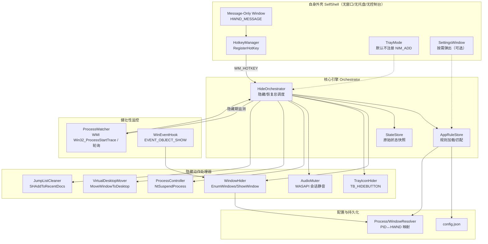
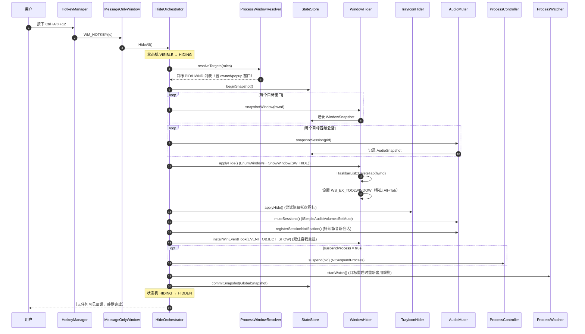
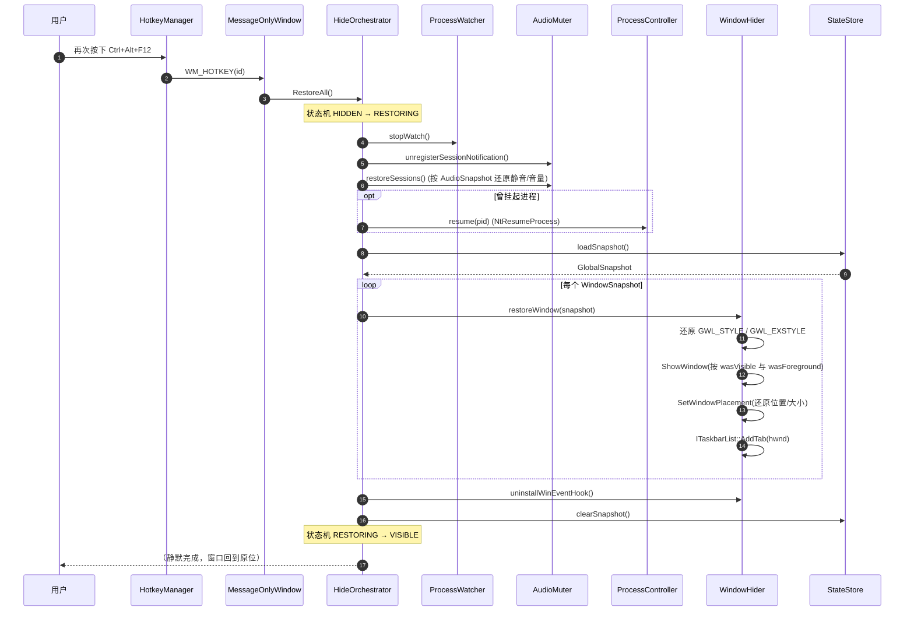
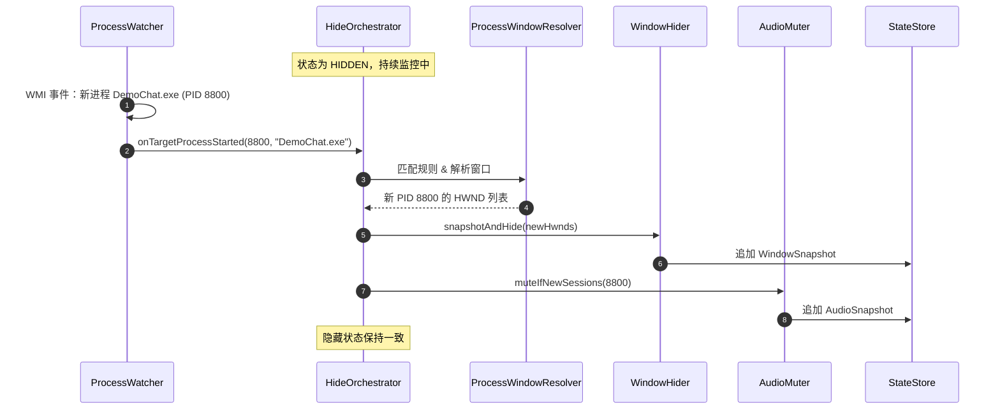
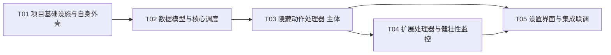

# 一键隐藏 / 恢复工具（Boss Key）— 架构设计与可行性分析

> 文档版本：v1.0
> 目标平台：Windows 10 / 11 x64
> 定位：**合法的隐私遮挡 / 老板键类工具（User Mode Only）**
> 读者：技术决策者、评审人、实现工程师
> 作者：架构师 高见远

---

## 0. 阅读须知（合规红线）

本设计**只采用用户态（User Mode）技术**，定位为"隐私遮挡 / 老板键"类合法工具，**不是恶意软件**。

**本方案明确拒绝，且不会给出任何可落地实现步骤的内核态 rootkit 类技术**：

- SSDT / Shadow SSDT Hook
- 内核 inline hook
- DKOM 摘链（操作 `EPROCESS.ActiveProcessLinks`）
- `PsSetCreateProcessNotifyRoutineEx` 篡改 / 回调摘除
- PPL 提权
- 驱动签名强制作弊（testsigning / DSE bypass / HVCI 绕过）
- ETW 抑制

凡涉及"隐藏进程"这一诉求，用户态**没有受支持 API**，任何实现路径都必然落到上述内核手段，属于被 Defender / EDR 判定为恶意软件的行为，且需要 EV 代码签名 + 微软 attestation 签名才能加载。**本设计只解释原理与为何不可行，不提供任何绕过实现。**

---

## 1. TL;DR 与可行性总览矩阵

### 1.1 一句话结论

| 隐藏诉求 | 结论 |
|---|---|
| 隐藏应用窗口 + 任务栏图标 | ✅ **可做**，本工具的核心能力 |
| 在任务管理器进程列表中隐藏进程 | ❌ **用户态无法实现**（需内核 rootkit，本方案拒绝） |
| 托盘图标隐藏 | ⚠️ **部分可做**：自身可做；他人图标 Win10 有限可行、Win11 无受支持 API |
| 静音 / 屏蔽应用声音 | ✅ **可做**（WASAPI），独占模式/ASIO 受限 |
| 隐藏程序自身全部痕迹 | ⚠️ **运行时痕迹可最小化，进程无法隐藏，持久化取证痕迹无法清除** |
| 补充项（挂起进程 / 防截屏 / 虚拟桌面 / 清空跳转列表） | ✅ / ⚠️ 视项而定，逐项标注 |

### 1.2 可行性总览矩阵

| # | 隐藏项 | 可行性 | 依赖技术 | 主要限制 |
|---|---|---|---|---|
| 1 | 隐藏应用窗口（含任务栏按钮） | ✅ 可行 | `EnumWindows` + `ShowWindow(SW_HIDE)` + `ITaskbarList::DeleteTab` + `SetWinEventHook` | 跨完整性级别受 UIPI 限制 → 工具需提权；部分应用自绘窗口需白名单兜底 |
| 2 | 在任务管理器进程列表隐藏/伪装进程 | ❌ 隐藏不可行 / ⚠️ 伪装有限 | 无（隐藏需内核驱动）；伪装靠 FileVersionInfo | 隐藏 = rootkit，被安全软件判定为恶意；伪装仅改"进程"页友好名，"详细信息"页仍显示真实映像名与路径 |
| 3a | 隐藏自身托盘图标 | ✅ 可行（trivial） | 根本不调用 `Shell_NotifyIcon(NIM_ADD)` | 无 |
| 3b | 隐藏他人托盘图标 | ⚠️ 分版本 | Win10 经典托盘 `ToolbarWindow32` + `TB_HIDEBUTTON`；Win11 无受支持 API | Win11 通知区域为 XAML 渲染，需退回注册表 + 重启 explorer 或用户手动隐藏；方案脆弱、随系统更新失效 |
| 4 | 静音 / 屏蔽应用声音 | ✅ 大部分可行 | WASAPI `IAudioSessionManager2` → `ISimpleAudioVolume::SetMute` + `IAudioSessionNotification` | 独占模式 / ASIO 绕过会话音量；只能改为挂起进程或全局静音端点 |
| 5a | 隐藏自身窗口 | ✅ 可行 | `WinMain` + message-only window（`HWND_MESSAGE`），不创建可见窗口 | 设置界面需"按需弹出" |
| 5b | 隐藏自身控制台 | ✅ 可行 | `WinMain` / `SUBSYSTEM:WINDOWS` | 无 |
| 5c | 隐藏自身进程（任务管理器不可见） | ❌ 不可行 | 同第 2 项 | 同第 2 项 |
| 5d | "隐藏"快捷键占用 | ❌ 伪需求 | 系统无 API 可枚举他人已注册热键 | 唯一可观测后果是冲突，故应选冷门组合 |
| 5e | 清除持久化取证痕迹（Run 键/Prefetch/Amcache/SRUM/4688 等） | ❌ 不可行 | 需篡改系统 | 清除行为本身即被安全软件重点监控的恶意特征；替代是"尽量不产生痕迹" |
| 6a | 挂起进程（冻结 CPU/网络） | ✅ 可行 | `NtSuspendProcess` / `NtResumeProcess`（`ntdll`） | 内存保留、可能触发应用/反作弊异常；不建议用于反作弊游戏 |
| 6b | 防截屏（自身窗口） | ⚠️ 仅自身 | `SetWindowDisplayAffinity(WDA_EXCLUDEFROMCAPTURE)` | **仅对调用进程自身顶层窗口生效**，对他人窗口不受支持 |
| 6c | 移到独立虚拟桌面 | ✅ 可行 | `IVirtualDesktopManager::MoveWindowToDesktop` | 需 Win10+；用户仍可切换桌面看到 |
| 6d | 清空跳转列表 / Jump List | ✅ 可行 | `SHAddToRecentDocs(SHARD_PATHW, nullptr)` 或 `IApplicationDestinations` | 只清近期列表，不清实际数据 |
| 6e | 隐藏 Alt+Tab 条目 | ✅ 可行（并入窗口隐藏） | `WS_EX_TOOLWINDOW` / `WS_EX_APPWINDOW` | 若窗口被隐藏则本就不在 Alt+Tab |
| 6f | 开机自启项隐藏 | ❌ 不可行（若需自启） | — | 自启即产生可审计痕迹，与"隐藏"矛盾；取舍："不注册自启"换取"无痕迹" |

---

## 2. 总体架构

### 2.1 设计原则

1. **纯用户态、零驱动、零内核 hook**——所有能力来自受支持的公开 API。
2. **快照-动作-恢复（Snapshot → Apply → Restore）**——隐藏前完整记录原始状态，恢复时逐字段还原，避免破坏目标应用状态。
3. **规则化多应用管理**——目标应用以配置描述，隐藏/恢复是"对所有匹配规则批量套用"。
4. **提权运行**——为突破 UIPI、操作高完整性窗口，主进程以管理员权限运行（UAC manifest `requireAdministrator`）。
5. **健壮性优先**——目标应用重启、新开窗口、会话重建时自动重新套用规则。

### 2.2 组件结构图



### 2.3 模块清单与职责

| 模块 | 文件（建议） | 职责 |
|---|---|---|
| **SelfShell** | `src/self/SelfShell.cpp` `src/self/main.cpp` | 进程入口；`WinMain`；创建 message-only window 接收 `WM_HOTKEY`；不注册控制台/托盘/可见窗口 |
| **HotkeyManager** | `src/self/HotkeyManager.cpp` | `RegisterHotKey`/`UnregisterHotKey`；从配置读取组合键；冲突处理 |
| **SettingsWindow** | `src/ui/SettingsWindow.cpp` | 可选的原生设置窗口，按需创建/销毁 |
| **HideOrchestrator** | `src/core/HideOrchestrator.cpp` | 核心调度：`HideAll()` / `RestoreAll()`；状态机（VISIBLE / HIDDEN）；串联各 Handler |
| **AppRuleStore** | `src/core/AppRuleStore.cpp` | 加载 `config.json`；规则匹配（exe 路径 / 进程名 / 窗口类名） |
| **StateStore** | `src/core/StateStore.cpp` | 保存/查询每个目标窗口与进程的原始状态快照 |
| **ProcessWindowResolver** | `src/core/ProcessWindowResolver.cpp` | PID ↔ HWND 归集；按 PID 枚举顶层/owned/popup 窗口 |
| **WindowHider** | `src/core/WindowHider.cpp` | `EnumWindows`→`ShowWindow(SW_HIDE)`；`ITaskbarList::DeleteTab`；`WS_EX_TOOLWINDOW` 切换；UWP `ApplicationFrameHost` 处理 |
| **TrayIconHider** | `src/core/TrayIconHider.cpp` | 隐藏他人托盘图标（Win10 经典托盘）；Win11 退回注册表方案 |
| **AudioMuter** | `src/core/AudioMuter.cpp` | WASAPI 会话枚举与静音；`IAudioSessionNotification` 监听新会话 |
| **ProcessController** | `src/core/ProcessController.cpp` | `NtSuspendProcess`/`NtResumeProcess` 挂起与恢复 |
| **VirtualDesktopMover** | `src/core/VirtualDesktopMover.cpp` | `IVirtualDesktopManager` 移动窗口到独立桌面 |
| **JumpListCleaner** | `src/core/JumpListCleaner.cpp` | 清空跳转列表 |
| **WinEventHook** | `src/core/WinEventHook.cpp` | `SetWinEventHook(EVENT_OBJECT_SHOW)` 兜住应用自我重显 |
| **ProcessWatcher** | `src/core/ProcessWatcher.cpp` | WMI `Win32_ProcessStartTrace` 或轮询，发现目标重启后重新套用规则 |

---

## 3. 数据模型

### 3.1 配置文件（JSON）Schema

配置文件默认路径：`%APPDATA%\HideUtil\config.json`（不写注册表）。首次运行时创建。

```jsonc
{
  "$schema": "https://example.com/hideutil/config.schema.json",
  "version": 1,
  "hotkey": {
    "hideToggle": {
      "modifiers": ["CTRL", "ALT"],   // CTRL | ALT | SHIFT | WIN
      "key": "F12"                     // 虚拟键名或 "VK_0x7B"
    }
  },
  "runtime": {
    "requireElevation": true,          // 需管理员权限以操作高完整性窗口
    "startHidden": true,               // 启动即无窗口/无托盘
    "registerAutostart": false,        // 默认不注册自启（降低痕迹）
    "pollIntervalMs": 1500             // 未用 WMI 时的轮询间隔
  },
  "rules": [
    {
      "id": "rule-001",
      "enabled": true,
      "name": "聊天客户端示例",
      "match": {
        "exePath": "C:\\Program Files\\DemoChat\\DemoChat.exe",  // 可选，绝对路径精确匹配
        "processName": "DemoChat.exe",                            // 可选，进程映像名匹配
        "windowClass": null,                                      // 可选，窗口类名匹配（较宽松）
        "matchMode": "any"                                        // any | all
      },
      "actions": {
        "hideWindow": true,           // 隐藏窗口 + 移除任务栏按钮
        "hideTrayIcon": true,         // 尝试隐藏其托盘图标
        "muteAudio": true,            // 静音其音频会话
        "suspendProcess": false,      // 是否挂起进程（谨慎开启）
        "moveToVirtualDesktop": false,// 移到独立虚拟桌面
        "hideFromAltTab": true,       // WS_EX_TOOLWINDOW
        "clearJumpList": false        // 恢复时是否清空跳转列表
      },
      "restore": {
        "restoreWindowPosition": true,   // 恢复窗口位置/大小
        "restoreForegroundWindow": true  // 恢复时为该窗口尝试置前
      }
    }
  ]
}
```

### 3.2 规则匹配说明

| 匹配字段 | 粒度 | 说明 |
|---|---|---|
| `exePath` | 最精确 | 绝对路径，防止同名进程误伤；推荐首选 |
| `processName` | 中等 | 映像名（如 `chrome.exe`），可能匹配多个实例 |
| `windowClass` | 宽松 | 窗口类名，用于多进程同 UI 框架场景 |
| `matchMode` | 组合 | `any`（任一命中即适用）/ `all`（全部满足才适用） |

> 一个"目标应用"通常含多个进程（如浏览器 + 渲染进程）。规则应作用于**主进程**及由它派生、且拥有顶层窗口的进程；`ProcessWindowResolver` 负责把拥有可见窗口的 PID 全部纳入。

### 3.3 原始状态快照（用于正确恢复）

隐藏前为每个目标窗口/进程记录以下快照，存入 `StateStore`（内存 + 可选落盘以便崩溃恢复）：

```cpp
struct WindowSnapshot {
    HWND   hwnd;
    DWORD  pid;
    BOOL   wasVisible;          // IsWindowVisible 原值
    LONG_PTR prevStyle;         // GetWindowLongPtr(GWL_STYLE) 原值
    LONG_PTR prevExStyle;       // GetWindowLongPtr(GWL_EXSTYLE) 原值
    BOOL   taskbarTabRemoved;   // 是否移除了任务栏按钮
    WINDOWPLACEMENT placement;  // 位置/大小/显示方式（正确还原）
    BOOL   wasForeground;       // 隐藏前是否为前台窗口
    BOOL   altTabSuppressed;    // 是否插入 WS_EX_TOOLWINDOW
};

struct AudioSnapshot {
    std::wstring sessionId;     // IAudioSessionControl2 的会话标识
    DWORD        pid;
    BOOL         wasMuted;      // 原始静音状态
    float        prevVolume;    // 原始音量
};

struct ProcessSnapshot {
    DWORD pid;
    BOOL  wasSuspended;         // 是否由本工具挂起
};

struct GlobalSnapshot {
    std::chrono::system_clock::time_point hiddenAt;
    std::vector<WindowSnapshot>  windows;
    std::vector<AudioSnapshot>   audio;
    std::vector<ProcessSnapshot> processes;
    BOOL moveToVirtualDesktopApplied;
};
```

### 3.4 类图（数据结构与服务接口）

```mermaid
classDiagram
    class HideOrchestrator {
        -HideState state
        -AppRuleStore* ruleStore
        -StateStore* stateStore
        -ProcessWindowResolver* resolver
        +HideAll() bool
        +RestoreAll() bool
        +OnTargetProcessStarted(pid, name) void
        +OnWindowShown(hwnd, pid) void
    }
    class AppRuleStore {
        -vector~AppRule~ rules
        +Load(path) bool
        +Save(path) bool
        +MatchByPid(pid) AppRule*
        +MatchByExe(name) AppRule*
    }
    class StateStore {
        -GlobalSnapshot snapshot
        +BeginSnapshot() void
        +AddWindow(WindowSnapshot) void
        +AddAudio(AudioSnapshot) void
        +AddProcess(ProcessSnapshot) void
        +Commit() void
        +Load() GlobalSnapshot
        +Clear() void
        +Persist(path) bool
    }
    class ProcessWindowResolver {
        +ResolveTargets(rules) vector~WindowRef~
        +CollectWindowsForPid(pid) vector~HWND~
        +CollectOwnedPopups(hwnd) vector~HWND~
        +IsUwpFrame(hwnd) bool
    }
    class WindowHider {
        +SnapshotWindow(hwnd) WindowSnapshot
        +ApplyHide(windows) bool
        +RestoreWindow(WindowSnapshot) bool
        +RemoveTaskbarTab(hwnd) void
        +AddTaskbarTab(hwnd) void
        +SetToolWindow(hwnd, enable) void
    }
    class TrayIconHider {
        +ApplyHide(pid) bool
        +Restore(pid) bool
    }
    class AudioMuter {
        +SnapshotSession(pid) AudioSnapshot
        +MuteSessions(pid) bool
        +RestoreSessions(snapshot) bool
        +RegisterSessionNotification() void
    }
    class ProcessController {
        +Suspend(pid) bool
        +Resume(pid) bool
    }
    class VirtualDesktopMover {
        +MoveToNewDesktop(hwnd) bool
        +RestoreWindow(hwnd) bool
    }
    class JumpListCleaner {
        +ClearAll() void
    }
    class WinEventHook {
        +Install(pidFilter) bool
        +Uninstall() void
    }
    class ProcessWatcher {
        +Start(callback) bool
        +Stop() void
    }
    class SelfShell {
        +Run() int
    }
    class HotkeyManager {
        +Register(hotkey) bool
        +Unregister() void
        +IsConflict() bool
    }
    class SettingsWindow {
        +ShowModal() void
        +Destroy() void
    }
    class AppRule {
        +string id
        +MatchSpec match
        +ActionSpec actions
        +RestoreSpec restore
    }
    class GlobalSnapshot {
        +time_point hiddenAt
        +vector~WindowSnapshot~ windows
        +vector~AudioSnapshot~ audio
        +vector~ProcessSnapshot~ processes
    }

    HideOrchestrator --> AppRuleStore : uses
    HideOrchestrator --> StateStore : uses
    HideOrchestrator --> ProcessWindowResolver : uses
    HideOrchestrator --> WindowHider : delegates
    HideOrchestrator --> TrayIconHider : delegates
    HideOrchestrator --> AudioMuter : delegates
    HideOrchestrator --> ProcessController : delegates
    HideOrchestrator --> VirtualDesktopMover : delegates
    HideOrchestrator --> JumpListCleaner : delegates
    HideOrchestrator --> WinEventHook : installs
    HideOrchestrator --> ProcessWatcher : monitors
    SelfShell --> HotkeyManager : owns
    SelfShell --> HideOrchestrator : owns
    SettingsWindow --> AppRuleStore : edits
    AppRuleStore "1" o-- "many" AppRule : contains
    StateStore --> GlobalSnapshot : holds
```



> 独立类图文件见 `docs/class-diagram.mermaid`；时序图见 `docs/sequence-diagram.mermaid`。

---

## 4. 核心流程时序图

### 4.1 隐藏流程（首次按下快捷键）



### 4.2 恢复流程（再次按下快捷键）



---

## 5. 逐项技术方案与限制

### 5.1 隐藏应用窗口（含任务栏图标） — ✅ 可行

**目标**：让目标应用的所有可见窗口消失，并从任务栏、Alt+Tab 中移除，恢复时原样还原。

**实现要点**：

1. **按 PID 归集窗口**：`EnumWindows` 遍历顶层窗口 → `GetWindowThreadProcessId` 取 PID → 与规则匹配的 PID 比对。对每个命中窗口，再用 `EnumChildWindows` / `GetWindow(GW_OWNER)` 收集其 owned / popup 窗口，避免遗漏对话框、右键菜单等。
2. **隐藏**：`ShowWindow(hwnd, SW_HIDE)`。
3. **移除任务栏按钮**：`ITaskbarList::DeleteTab(hwnd)`（需 `CoCreateInstance(CLSID_TaskbarList)`，调用前 `HrInit()`）。恢复时 `ITaskbarList::AddTab(hwnd)`。
4. **移出 Alt+Tab**：临时 set `WS_EX_TOOLWINDOW` 并清 `WS_EX_APPWINDOW`（`SetWindowLongPtr` + `SetWindowPos(SWP_FRAMECHANGED)`），恢复时还原原扩展样式。注意：窗口被 `SW_HIDE` 后本就不出现在 Alt+Tab，此项主要针对"窗口未隐藏但需从 Alt+Tab 移除"的场景。
5. **兜住自我重显**：目标应用可能监听自身被隐藏并重新 `ShowWindow`。用 `SetWinEventHook(EVENT_OBJECT_SHOW, ...)` 全进程监听，一旦命中 PID 立即再次隐藏。恢复时卸载钩子。
6. **UWP / ApplicationFrameHost**：UWP 应用的顶层窗口由 `ApplicationFrameHost.exe` 承载，真实 UI 在子进程中。需通过 `ApplicationFrameHost` 的 owned 子窗口向上溯源，或按 `ApplicationFrameHost` 窗口的子进程 PID 归集，不能仅按目标 PID 匹配顶层窗口。

**关键限制**：

- **UIPI（用户界面特权隔离）**：非提权进程**无法**操作高完整性级别（管理员运行）的目标窗口——`ShowWindow`、`SetWindowLongPtr` 等会被静默忽略或返回失败。**因此本工具必须以管理员权限运行**（UAC manifest `requireAdministrator`）。
- 目标若自行创建"置顶覆盖层"或自绘任务栏替代品，可能造成视觉残留。
- 部分受保护进程（PPL，如反作弊、某些系统组件）即使提权也无法操作其窗口。

---

### 5.2 进程隐藏 / 伪装 — ❌ 隐藏不可行 / ⚠️ 伪装受限

**结论（用户态无法隐藏进程）**：

任务管理器、Process Explorer 等工具通过内核提供的系统信息接口枚举进程，典型如：

- `NtQuerySystemInformation(SystemProcessInformation, ...)`
- `NtQueryInformationProcess`
- `EnumProcesses`（内部走 `NtQuerySystemInformation`）

这些接口由内核 `ntoskrnl` 从 `EPROCESS` 链表中实时生成快照。**用户态没有任何受支持的 API 能够"隐藏"一个进程**——进程的存在与否完全由内核维护的数据结构决定，用户态无法更改。

**为什么任何"实现路径"都必然落到 rootkit**：

要在进程列表中隐藏一个进程，唯一"有效"的思路是让枚举接口的输出与真实进程列表不一致，这只能通过以下内核态手段实现：

- DKOM 摘链：把目标 `EPROCESS` 从 `ActiveProcessLinks` 双向链表中摘除；
- 在内核层 hook `NtQuerySystemInformation` / `ZwQuerySystemInformation`；
- 篡改进程回调（`PsSetCreateProcessNotifyRoutineEx`）等。

以上全部属于 rootkit 行为。它们：

1. 会被 Microsoft Defender / 主流 EDR 判定为恶意软件并查杀；
2. 需要**内核驱动签名**，且在现代 Windows 上要绕过 **DSE（驱动签名强制）/ HVCI / PatchGuard / PPL** 才能加载，而这些绕过本身即攻击行为；
3. 合法用途（如 PPL 保护的服务）需要 **EV 代码签名 + 微软 attestation 签名**，个人开发者无法获取。

**因此本方案明确定义为"不可达成目标"，且不提供任何实现步骤。**

**合法替代——"伪装"（受限）**：

伪装的目标不是"隐藏"，而是**降低辨识度**，在合法边界内：

- **版本信息资源**：在构建时把目标 EXE 的 `FileDescription` / `ProductName` / `CompanyName` 设为中性友好名（如 "Windows 组件"），任务管理器"进程"页会显示该友好名。
- **目录中性化**：把可执行文件放在语义中性的目录（如 `%LocalAppData%\Microsoft\<中性名>`）。
- **不注册开机自启**：不写 `Run` 键、不建计划任务，降低被发现的概率。

**必须如实说明的限制**：任务管理器"**详细信息**"页仍会显示**真实映像名**（`DemoChat.exe`）与**完整路径**，进程页的友好名只是显示层差异，**伪装只是"降低辨识度"，绝不是真正的隐藏**。且伪装只对本工具能修改自身/自身部署资源的场景成立，无法（也不应）篡改他人应用的签名资源。

---

### 5.3 托盘图标隐藏 — ⚠️ 分版本，部分可行

#### 5.3.1 隐藏"自身"托盘图标 — ✅ 可行（trivial）

本工具**根本不调用 `Shell_NotifyIcon(NIM_ADD)`**，即不创建托盘图标，因此无需"隐藏"。

#### 5.3.2 隐藏"他人"托盘图标

**Win10 经典通知区域（基于 `ToolbarWindow32`）**：可通过窗口层级定位通知区域：

```
Shell_TrayWnd → TrayNotifyWnd → SysPager → ToolbarWindow32
```

向该 Toolbar 发送 `TB_HIDEBUTTON`（按但索引隐藏）或 `TB_DELETEBUTTON`（删除按钮）。需跨进程写 `TBHDR` 结构（`VirtualAllocEx`/`WriteProcessMemory` 到 `explorer.exe`），并在操作前后做 `GetWindowThreadProcessId` 权限附加。

**Win11 通知区域**：已改为 **XAML 渲染**，不再有 `ToolbarWindow32`，**没有受支持的公开 API 可以隐藏他人托盘图标**。

**退化方案（脆弱，需明示）**：

- 写 `HKCU\Control Panel\NotifyIconSettings\<hash>\IsPromoted`（或对应可见性键）后**需重启 `explorer.exe` 才生效**——重启 explorer 会造成全局任务栏闪烁，体验差；
- 或引导用户**手动在"设置 → 个性化 → 任务栏 → 其他系统托盘图标"中隐藏**（最稳妥，但非自动）。

**限制总结**：他人托盘图标隐藏方案**高度依赖系统实现细节，随 Windows 更新极易失效**；Win11 上无可靠自动方案。应在文档与 UI 中如实告知用户"此项在不同 Windows 版本上表现不一致，可能需手动辅助"。

---

### 5.4 静音 / 屏蔽应用声音 — ✅ 大部分可行

**实现要点（WASAPI 会话静音）**：

1. `CoCreateInstance(CLSID_MMDeviceEnumerator)`；
2. `IMMDeviceEnumerator::GetDefaultAudioEndpoint(eRender, eConsole, ...)` 获取默认渲染端点；
3. `IAudioSessionManager2::GetSessionEnumerator()` 枚举所有音频会话；
4. 对每个 `IAudioSessionControl` → `QueryInterface(IAudioSessionControl2)` → `GetProcessId()` 取 PID；
5. 与目标 PID 比对，命中则 `QueryInterface(ISimpleAudioVolume)` → `SetMute(TRUE, ...)` 并记录原音量；
6. **持续静音**：实现 `IAudioSessionNotification`（`OnSessionCreated`）监听**新会话**（应用可能在隐藏期间新建音频会话），新会话命中目标 PID 立即静音。

**恢复**：按 `AudioSnapshot` 还原 `SetMute` 与 `SetVolume` 原值。

**关键限制**：

- **独占模式（WASAPI Exclusive Mode）/ ASIO**：绕过系统混音器的**会话音量控制**，`ISimpleAudioVolume::SetMute` 对其**无效**。此时替代方案：
  - 挂起目标进程（`NtSuspendProcess`，见 6.1）——会冻结 CPU/网络活动，副作用大；
  - 静音整个音频端点（`IMMDevice::SetMute`）——**影响全局所有应用**，代价大。
- 应用若在隐藏期间重建音频设备/端点，需重新枚举。

---

### 5.5 隐藏程序自身的全部痕迹 — ⚠️ 运行时痕迹可最小化，其余不可达成

| 子项 | 结论 | 说明 |
|---|---|---|
| 自身窗口 | ✅ 可行 | 使用 **message-only window**（`CreateWindowEx` 传 `HWND_MESSAGE` 作父窗口）接收 `WM_HOTKEY`，不创建任何可见窗口 |
| 自身托盘图标 | ✅ 可行 | 不调用 `Shell_NotifyIcon` |
| 自身控制台 | ✅ 可行 | 入口用 `wWinMain`，链接器 `/SUBSYSTEM:WINDOWS`，不创建控制台 |
| 自身的进程（任务管理器不可见） | ❌ 不可行 | 同 5.2，用户态无法隐藏进程 |
| 快捷键"占用"隐藏 | ❌ 伪需求 | 见下方说明 |
| 持久化取证痕迹清除 | ❌ 不可行 | 见下方说明 |

**关于"隐藏快捷键占用"**：

`RegisterHotKey` 注册的全局热键，**系统没有任何 API 可供第三方枚举"别人注册了哪些热键"**——即"隐藏热键占用"这一诉求在技术上**本质上不存在**（没有被枚举的入口，也就无需隐藏）。唯一可观测的后果是**热键冲突**（目标组合被占用时 `RegisterHotKey` 返回 `ERROR_HOTKEY_ALREADY_REGISTERED`）。因此正确做法是**选择冷门组合键**并在启动时检测冲突。

> 备选：底层键盘钩子 `WH_KEYBOARD_LL` 可实现"不占用热键"的全局按键监听，但它属于全局键盘钩子，**极易被安全软件判定为键盘记录行为**，且需要消息循环不及时会被系统移除。本方案**默认不采用**，仅作为技术备选说明。

**关于"持久化取证痕迹清除"**：

以下系统级痕迹**无法在不篡改系统的前提下清除**：

- 注册表 `Run` / `RunOnce` 键、任务计划（若曾注册自启）；
- **Prefetch**（`C:\Windows\Prefetch\*.pf`，记录程序执行）；
- **Amcache / ShimCache**（`Amcache.hve`、`SYSTEM` 中兼容性缓存）；
- **SRUM**（系统资源使用监控数据库）；
- **事件日志 4688**（进程创建审计）等。

**如实说明**：清除上述痕迹的行为**本身即为安全软件重点监控的恶意特征**（T1070 Indicator Removal），会被实时防护拦截。因此**正确的替代策略是"尽量减少痕迹的产生"**，而非"事后清除"：

- 不注册开机自启；
- 无窗口 / 无托盘 / 无控制台；
- 使用 message-only window，不产生常驻可见 UI；
- 仅从用户配置目录读取配置，不写无关注册表位置。

---

### 5.6 其他合理补充项（自行补充并说明）

| 补充项 | 可行性 | 技术 | 限制 |
|---|---|---|---|
| **挂起进程**（冻结 CPU/网络活动，保留内存） | ✅ | `NtSuspendProcess` / `NtResumeProcess`（`ntdll`，动态加载） | 内存保留；可能触发应用/反作弊异常，**不建议用于反作弊游戏**；挂起时文件句柄仍占用 |
| **防截屏** | ⚠️ 仅自身 | `SetWindowDisplayAffinity(hwnd, WDA_EXCLUDEFROMCAPTURE)` | **仅对调用进程自身的顶层窗口生效**；对他人窗口不受支持，无法"让别人的窗口不被截图" |
| **移到独立虚拟桌面** | ✅ | `IVirtualDesktopManager::MoveWindowToDesktop` | 需 Win10+；用户仍可切换到该桌面看到窗口 |
| **清空跳转列表 / Jump List** | ✅ | `SHAddToRecentDocs(SHARD_PATHW, nullptr)`（清空全部）或 `IApplicationDestinations` | 仅清"最近/固定"列表，不清实际业务数据 |
| **隐藏 Alt+Tab 条目** | ✅ | 并入 5.1（`WS_EX_TOOLWINDOW`） | 窗口隐藏后本就不在 Alt+Tab |
| **最小化而非隐藏**（弱遮挡，降低误伤） | ✅ | `ShowWindow(SW_MINIMIZE)` | 任务栏按钮仍在；可作为"温和模式"选项 |
| **黑屏覆盖层**（自绘全屏遮挡，覆盖屏幕） | ✅ | 创建自身全屏顶层窗口 | 属"遮挡"而非"隐藏"，可能被 Windows 焦点抢占；且覆盖层本身是可见窗口 |

---

## 6. 不可达成目标清单

以下目标**在当前系统权限与安全机制下无法达成**，逐项给出理由：

| # | 目标 | 结论 | 理由 |
|---|---|---|---|
| 1 | 在任务管理器中隐藏目标进程 | ❌ 不可行 | 枚举经 `NtQuerySystemInformation(SystemProcessInformation)` 由内核从 `EPROCESS` 实时生成；用户态无受支持 API 可隐藏进程；实现必然落到内核驱动 + 绕过 DSE/PatchGuard/HVCI，属 rootkit |
| 2 | 在任务管理器中隐藏**自身**进程 | ❌ 不可行 | 同第 1 项 |
| 3 | 隐藏 Win11 上**他人**托盘图标 | ❌ 不可行 | Win11 通知区域为 XAML 渲染，无受支持 API；只能注册表 + 重启 explorer 或用户手动，属"脆弱/半自动"而非可靠隐藏 |
| 4 | "隐藏"自身快捷键占用 | ❌ 伪需求 | 系统无 API 可枚举他人已注册热键；唯一后果是冲突，无从隐藏（也无需隐藏） |
| 5 | 清除持久化取证痕迹（Run/Prefetch/Amcache/SRUM/4688） | ❌ 不可行 | 需篡改系统；清除行为本身即被安全软件重点监控的恶意特征 |
| 6 | 对**他人**窗口防截屏 | ❌ 不可行 | `WDA_EXCLUDEFROMCAPTURE` 仅对调用进程自身顶层窗口生效 |
| 7 | 隐藏开机自启项 | ❌ 不可行（若需自启） | 自启即产生可审计痕迹，与"隐藏"本质矛盾；取舍为"不注册自启" |

---

## 7. 目标应用在隐藏期间发生变化时的健壮性设计

隐藏期间目标应用可能**重启**、**新开窗口**、**重建音频会话**。为保持隐藏状态一致，需持续监控并自动重新套用规则。

### 7.1 监控策略

| 变化类型 | 监控手段 | 响应 |
|---|---|---|
| 进程重启 / 新进程启动 | **首选** WMI `Win32_ProcessStartTrace`（`Wbem` 事件订阅）；**备选** 轮询 `EnumProcesses`（`pollIntervalMs`，默认 1500ms） | 命中规则 → 对新 PID 重新执行 5.1 / 5.4 隐藏动作 |
| 目标自我重显窗口 | `SetWinEventHook(EVENT_OBJECT_SHOW, EVENT_OBJECT_SHOW, ...)` 全进程监听 | 命中 PID → 立即再次 `ShowWindow(SW_HIDE)` |
| 新音频会话 | `IAudioSessionNotification::OnSessionCreated` | 命中 PID → 立即 `SetMute` |
| 应用崩溃 / 退出 | ProcessWatcher 检测进程消失 | 从活动集合移除该 PID；快照保留供用户手动恢复 |

### 7.2 状态机与幂等性

`HideOrchestrator` 维护状态机：`VISIBLE → HIDING → HIDDEN → RESTORING → VISIBLE`。

- **幂等**：重复 `HideAll()` 在 `HIDDEN` 态为 no-op；重复 `RestoreAll()` 在 `VISIBLE` 态为 no-op。
- **增量**：隐藏期间新出现的 PID，仅对其执行隐藏动作，并**追加**到 `GlobalSnapshot`，恢复时一并还原。
- **崩溃恢复**（可选增强）：将 `GlobalSnapshot` 落盘（`%APPDATA%\HideUtil\state.json`），进程异常退出后在下次启动时提示"上次未正常恢复，是否恢复原状"。

### 7.3 时序（目标重启自动重套用）



---

## 8. 实现任务列表（有序，标注依赖）

> 按实现顺序排列；每个任务给出涉及文件相对路径。任务数 ≤ 5，按功能模块分组（不按单文件拆）。

| 任务 | 名称 | 依赖 | 优先级 | 涉及文件 |
|---|---|---|---|---|
| **T01** | **项目基础设施与自身外壳** | — | P0 | `CMakeLists.txt` `CMakePresets.json` `src/main.cpp`（`wWinMain`）`src/self/SelfShell.h/.cpp`（message-only window）`src/self/HotkeyManager.h/.cpp` `src/self/Logger.h/.cpp` `app.manifest`（`requireAdministrator`）`resources/config.schema.json` |
| **T02** | **数据模型与核心调度** | T01 | P0 | `src/core/Types.h`（快照结构体）`src/core/AppRuleStore.h/.cpp`（JSON 规则加载/匹配）`src/core/StateStore.h/.cpp`（快照存取）`src/core/ProcessWindowResolver.h/.cpp`（PID↔HWND 归集）`src/core/HideOrchestrator.h/.cpp`（状态机/调度） |
| **T03** | **隐藏动作处理器（主体）** | T02 | P0 | `src/core/WindowHider.h/.cpp`（`EnumWindows`/`ShowWindow`/`ITaskbarList`/`WS_EX_TOOLWINDOW`/UWP）`src/core/AudioMuter.h/.cpp`（WASAPI 会话静音 + `IAudioSessionNotification`）`src/core/WinEventHook.h/.cpp`（兜住自我重显）`src/core/TrayIconHider.h/.cpp`（Win10 经典托盘 + Win11 退化） |
| **T04** | **扩展处理器与健壮性监控** | T03 | P1 | `src/core/ProcessController.h/.cpp`（`NtSuspendProcess`/`NtResumeProcess`）`src/core/VirtualDesktopMover.h/.cpp`（`IVirtualDesktopManager`）`src/core/JumpListCleaner.h/.cpp`（`SHAddToRecentDocs`）`src/core/ProcessWatcher.h/.cpp`（WMI/轮询） |
| **T05** | **设置界面、集成与联调** | T03, T04 | P1 | `src/ui/SettingsWindow.h/.cpp`（按需弹出原生窗口）`src/ui/SettingsWindow.rc`（资源）`docs/02-使用说明与限制.md`（面向用户如实说明各限制）`tests/smoke_test.cpp`（核心流程冒烟测试） |

**依赖图**：



### 任务实现要点提示

- **T01**：`/SUBSYSTEM:WINDOWS`、`wWinMain`、`app.manifest` 声明 `requireAdministrator`；`HotkeyManager` 需处理 `RegisterHotKey` 返回 `ERROR_HOTKEY_ALREADY_REGISTERED`。
- **T02**：`AppRuleStore` 用 `nlohmann/json` 解析；`ProcessWindowResolver` 需覆盖 owned/popup/child 窗口与 `ApplicationFrameHost` UWP 场景。
- **T03**：`WindowHider` 与 `AudioMuter` 是核心；务必成对实现 `snapshot` 与 `restore`。`ITaskbarList` 需在 STA 线程使用（`CoInitializeEx(COINIT_APARTMENTTHREADED)`）。
- **T04**：`ntdll` 的 `NtSuspendProcess`/`NtResumeProcess` 用 `GetProcAddress` 动态获取，避免静态链接依赖；`ProcessWatcher` 的 WMI 订阅需在独立线程跑消息泵。
- **T05**：设置窗口**按需创建**，关闭即销毁（不常驻，降低痕迹）；文档必须如实转达第 5、6 节的限制。

---

## 9. 依赖与构建清单

### 9.1 第三方库

| 库 | 用途 | 获取方式 |
|---|---|---|
| **nlohmann/json** | 解析 `config.json` / `state.json` | 单头文件，vendored 或 vcpkg |
| **WIL（Windows Implementation Library）** | 简化 Win32/COM 错误处理与 RAII（可选） | vcpkg / NuGet |
| **spdlog**（可选） | 可选日志（默认关闭以免产生痕迹） | vcpkg |

> 原则：**优先减少第三方依赖以缩小体积与攻击面**。核心隐藏能力全部来自 Windows 系统 API，不引入额外运行时。

### 9.2 Windows 系统库

| 库 | 用途 |
|---|---|
| `user32` | 窗口枚举、`ShowWindow`、`SetWinEventHook`、`RegisterHotKey` |
| `ole32` | COM 初始化、`CoCreateInstance` |
| `oleaut32` | 部分 COM 支持 |
| `comctl32` | `ITaskbarList`、通用控件 |
| `shlwapi` | Shell 辅助（跳转列表等） |
| `shcore` | DPI 感知 |
| `shell32` | `SHAddToRecentDocs`、`Shell_NotifyIcon` |
| `wbemuuid` / `wbem` | 可选（WMI `Win32_ProcessStartTrace`） |
| `ntdll` | 运行时动态加载 `NtSuspendProcess`/`NtResumeProcess`（**不静态链接**） |

### 9.3 CMake 要点

```cmake
cmake_minimum_required(VERSION 3.20)
project(HideUtil CXX)
set(CMAKE_CXX_STANDARD 20)
set(CMAKE_CXX_STANDARD_REQUIRED ON)
add_executable(HideUtil WIN32  # WIN32 => /SUBSYSTEM:WINDOWS，无控制台
    src/main.cpp
    # ... 其余源文件
)
target_compile_definitions(HideUtil PRIVATE
    UNICODE _UNICODE
    WIN32_LEAN_AND_MEAN NOMINMAX
)
target_link_libraries(HideUtil PRIVATE
    user32 ole32 oleaut32 comctl32 shlwapi shcore shell32
    # ntdll 不链接，运行时 GetProcAddress
)
# 嵌入 requireAdministrator manifest
target_sources(HideUtil PRIVATE app.manifest)
```

### 9.4 编译器与最低系统版本

- **编译器**：MSVC 2022（v143 工具集），C++20；
- **最低系统**：Windows 10 1809（x64）——`SetWindowDisplayAffinity(WDA_EXCLUDEFROMCAPTURE)` 需 2004+，`IVirtualDesktopManager` 需 Win10+，Win11 部分托盘能力受限；
- **架构**：x64（可选提供 ARM64 构建）；
- **运行权限**：管理员（`requireAdministrator`）。

---

## 10. 共享知识 / 跨文件约定

| 约定 | 内容 |
|---|---|
| **命名空间** | 统一 `namespace hideutil {}`；子模块用 `hideutil::core`、`hideutil::self`、`hideutil::ui` |
| **错误处理** | Win32 调用失败返回 `bool` + `GetLastError()`；跨模块用 `Result<T>`（`std::optional<T>` 或自定义 `struct { T value; HRESULT hr; }`）；COM 用 `HRESULT` + `FAILED()` 判定；**不抛异常穿越模块边界** |
| **日志策略** | 默认**关闭**日志（避免产生痕迹）；调试构建可开 `OutputDebugString`；不使用文件日志，除非用户显式开启 |
| **PID ↔ HWND 映射** | 由 `ProcessWindowResolver` 统一负责；其他模块**不直接** `EnumWindows`，一律经 Resolver 获取，保证一致性与 UWP 处理集中 |
| **快照配对** | 每个 `applyXxx()` 必须有对应 `restoreXxx()`；快照键为 `HWND`（窗口）与 `sessionId`（音频） |
| **COM 线程模型** | 主线程 STA（`COINIT_APARTMENTTHREADED`）；WMI/会话通知等后台任务用 MTA 子线程，各自 `CoInitializeEx` |
| **权限校验** | 启动时用 `IsUserAnAdmin()` 或检测 token elevation，非管理员则提示以管理员重启（否则功能受限） |
| **字符串** | 全 Unicode（`wchar_t`），`UNICODE/_UNICODE` 已定义 |
| **配置路径** | `%APPDATA%\HideUtil\`；不写 `HKLM`，尽量不写 `HKCU` |

---

## 11. 风险与待明确事项

### 11.1 权限模型

- **需明确**：是否一定以管理员运行？管理员权限可解决 UIPI、操作高完整性窗口，但**会触发 UAC 弹窗**，与"低调"目标有张力。建议：**默认要求提权**（功能完整），在文档中说明 UAC 弹窗不可避免；提供"不提权模式"（仅能操作同/低完整性窗口）作为降级选项。

### 11.2 目标应用类型范围

- **Win32 传统应用**：支持最好；
- **UWP**：需 `ApplicationFrameHost` 特殊处理，部分系统组件无法操作；
- **游戏 / 反作弊**：`NtSuspendProcess`、`SetWindowDisplayAffinity` 等可能触发反作弊（BattlEye/EAC/Vanguard）误判甚至封号——**强烈建议在文档中警示，并对反作弊进程默认禁用挂起/防截屏动作**；
- **受 PPL 保护的进程**：即使提权也无法操作其窗口/进程。

### 11.3 用户使用场景边界

- 本工具定位**合法隐私遮挡**（如临时遮挡私人聊天窗口）；
- 严禁用于规避监控/审计、隐藏恶意行为；文档需明确该边界；
- 若用于他人设备，涉及法律与伦理风险，需用户自行负责。

### 11.4 其他风险

| 风险 | 影响 | 缓解 |
|---|---|---|
| 系统更新导致托盘/任务栏方案失效 | 某项功能失效 | 版本检测 + 优雅降级 + 文档明示 |
| 隐藏后未能恢复，目标窗口"丢失" | 用户困惑 | 崩溃恢复（state.json）+ "一键全部恢复"入口 |
| 与目标应用自身热键/快捷键冲突 | 热键注册失败 | 启动检测冲突 + 冷门组合默认值 |
| 提权被杀软误报 | 安装/运行受阻 | 明确功能边界、不实现任何 rootkit 行为、可选代码签名 |
| 挂起/防截图触发反作弊 | 封号 | 默认对反作弊进程禁用这些动作 |

### 11.5 待明确事项（需产品/用户决策）

1. **默认热键**取什么冷门组合？（建议 `Ctrl+Alt+F12`）
2. 是否提供"温和模式"（仅最小化）与"强力模式"（隐藏 + 挂起）两档？
3. 设置界面是否需要？还是纯配置文件驱动？
4. 是否需要代码签名（影响分发与误报率）？
5. 目标应用清单是否由用户手动指定（推荐）还是自动发现？

---

## 12. 附：技术栈推荐

**推荐：C++17/20 + Win32 API（原生）**。

| 维度 | C++ / Win32（推荐） | C# / .NET 8 + P/Invoke |
|---|---|---|
| 体积 / 依赖 | 小，无运行时依赖 | 需 .NET 运行时（或 self-contained，体积大） |
| 痕迹 / 启动开销 | 小，易做无窗口/无托盘 | 略大 |
| 系统 API 覆盖 | **最完整**（可直接用所有 Win32/COM/WASAPI API） | 需大量 P/Invoke 声明，部分 API 繁琐 |
| 开发效率 | 较低 | **高** |
| 权限面 | 提权后可获最大用户态权限面 | 同（提权后一致） |

**理由**：本工具的核心诉求是"**最小痕迹 + 最大用户态权限面 + 精确控制窗口/音频/进程状态**"，C++/Win32 在体积、启动痕迹、API 覆盖面上均占优；且 `requireAdministrator` manifest、message-only window、WASAPI 会话控制等原生实现最直接。**C#/.NET 8** 仅作为快速原型备选（开发效率高，但需运行时、体积与启动开销更大）。

---

## 13. 结论摘要

- **可做（核心能力）**：隐藏应用窗口 + 任务栏按钮 + Alt+Tab 条目、静音音频会话、隐藏自身全部运行时痕迹（无窗口/无托盘/无控制台）、清空跳转列表、移动到虚拟桌面、挂起进程。
- **部分可做（受限）**：托盘图标隐藏（Win10 有限、Win11 无受支持 API）、进程"伪装"（仅降低辨识度，非隐藏）、防截屏（仅自身窗口）、独占模式/ASIO 音频静音。
- **不可做（明确告知用户）**：在任务管理器隐藏目标/自身进程、Win11 他人托盘图标可靠隐藏、隐藏快捷键占用（伪需求）、清除持久化取证痕迹、对他人窗口防截屏、开机自启项隐藏。
- **技术栈**：C++20 + Win32 API（原生），提权运行，零驱动、零内核 hook。
- **任务数**：5 个（T01 基础设施/外壳 → T02 数据模型/调度 → T03 隐藏动作主体 → T04 扩展/健壮性 → T05 设置界面/集成）。

---

*本文档严格限定于用户态合法方案，对"进程隐藏"等不可达成目标给出明确结论与原理说明，不提供任何内核 rootkit 或绕过驱动签名强制/PatchGuard/HVCI 的实现步骤。*
