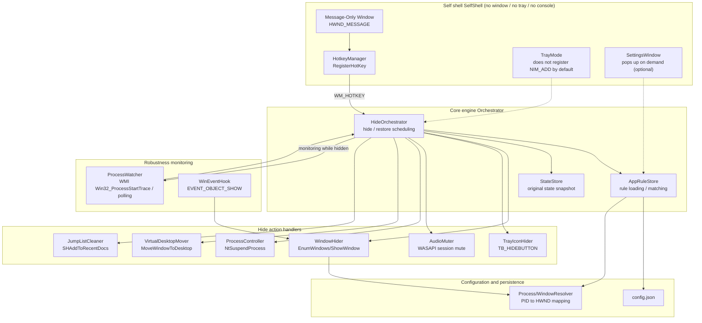
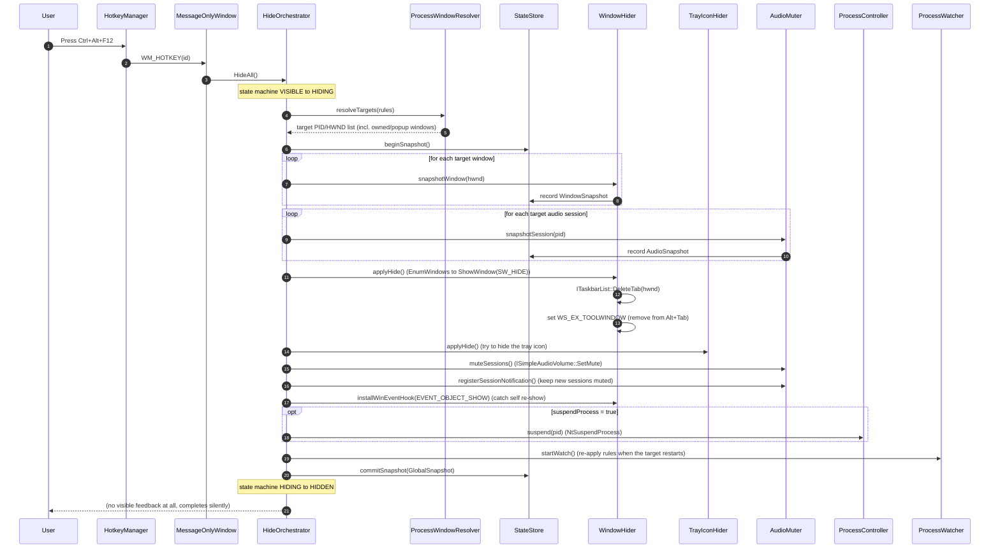
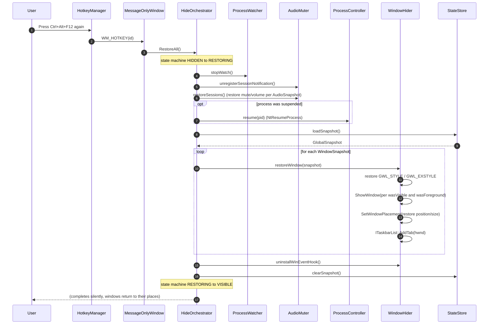
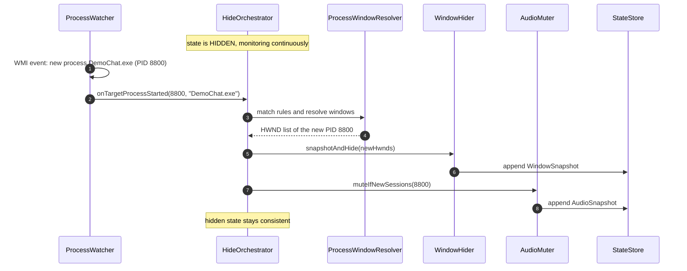
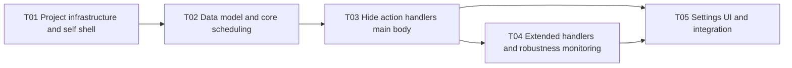

# One-Click Hide / Restore Tool (Boss Key) — Architecture Design and Feasibility Analysis

> Document version: v1.0
> Target platform: Windows 10 / 11 x64
> Positioning: **a legitimate privacy-shielding / boss-key style tool (User Mode Only)**
> Audience: technical decision makers, reviewers, implementation engineers

---

## 0. Reading Notice (Compliance Red Lines)

This design **uses user-mode (User Mode) techniques only**. It is positioned as a legitimate "privacy shielding / boss key" class tool and is **not malware**.

**This proposal explicitly rejects, and will not give any actionable implementation steps for, the following kernel-mode rootkit class techniques**:

- SSDT / Shadow SSDT Hook
- Kernel inline hook
- DKOM unlinking (manipulating `EPROCESS.ActiveProcessLinks`)
- `PsSetCreateProcessNotifyRoutineEx` tampering / callback removal
- PPL privilege escalation
- Driver signature enforcement cheating (testsigning / DSE bypass / HVCI bypass)
- ETW suppression

Wherever the requirement is to "hide a process", user mode **has no supported API**; every implementation path necessarily lands on the kernel techniques listed above, which Defender / EDR classify as malware and which additionally require EV code signing plus Microsoft attestation signing in order to load. **This design only explains the principles and why they are infeasible; it does not provide any bypass implementation.**

---

## 1. TL;DR and Feasibility Overview Matrix

### 1.1 One-Sentence Conclusion

| Hiding requirement | Conclusion |
|---|---|
| Hiding an application window + taskbar icon | ✅ **Doable** — the core capability of this tool |
| Hiding a process in the Task Manager process list | ❌ **Not achievable in user mode** (requires a kernel rootkit, rejected by this proposal) |
| Tray icon hiding | ⚠️ **Partially doable**: own icon is trivial; other applications' icons are limited on Win10 and have no supported API on Win11 |
| Muting / blocking application sound | ✅ **Doable** (WASAPI); limited under exclusive mode / ASIO |
| Hiding all traces of the tool itself | ⚠️ **Runtime traces can be minimized; the process cannot be hidden; persistent forensic traces cannot be erased** |
| Supplementary items (suspend process / anti-screen-capture / virtual desktop / clear jump list) | ✅ / ⚠️ depends on the item, annotated individually |

### 1.2 Feasibility Overview Matrix

| # | Hiding item | Feasibility | Underlying technology | Main limitations |
|---|---|---|---|---|
| 1 | Hiding an application window (incl. taskbar button) | ✅ Feasible | `EnumWindows` + `ShowWindow(SW_HIDE)` + `ITaskbarList::DeleteTab` + `SetWinEventHook` | Cross-integrity-level operations are restricted by UIPI → the tool must be elevated; some self-drawn windows need a whitelist fallback |
| 2 | Hiding / disguising a process in the Task Manager process list | ❌ Hiding infeasible / ⚠️ Disguising limited | None (hiding requires a kernel driver); disguising relies on FileVersionInfo | Hiding = rootkit, flagged as malicious by security software; disguising only changes the friendly name on the "Processes" page — the "Details" page still shows the real image name and path |
| 3a | Hiding our own tray icon | ✅ Feasible (trivial) | Simply never call `Shell_NotifyIcon(NIM_ADD)` | None |
| 3b | Hiding another application's tray icon | ⚠️ Version-dependent | Win10 classic tray: `ToolbarWindow32` + `TB_HIDEBUTTON`; Win11 has no supported API | On Win11 the notification area is XAML-rendered; must fall back to the registry + restarting explorer or manual hiding by the user; the approach is fragile and breaks with system updates |
| 4 | Muting / blocking application sound | ✅ Mostly feasible | WASAPI `IAudioSessionManager2` → `ISimpleAudioVolume::SetMute` + `IAudioSessionNotification` | Exclusive mode / ASIO bypass session volume; the only alternatives are suspending the process or muting the endpoint globally |
| 5a | Hiding our own window | ✅ Feasible | `WinMain` + message-only window (`HWND_MESSAGE`), no visible window is created | The settings UI must be "popped up on demand" |
| 5b | Hiding our own console | ✅ Feasible | `WinMain` / `SUBSYSTEM:WINDOWS` | None |
| 5c | Hiding our own process (invisible in Task Manager) | ❌ Infeasible | Same as item 2 | Same as item 2 |
| 5d | Hiding a hotkey registration | ❌ Pseudo-requirement | The system has no API to enumerate hotkeys registered by others | The only observable consequence is a conflict, so an uncommon combination should be chosen |
| 5e | Erasing persistent forensic traces (Run keys / Prefetch / Amcache / SRUM / 4688, etc.) | ❌ Infeasible | Requires tampering with the system | The erasure itself is a malicious indicator that security software watches closely; the alternative is "produce as few traces as possible" |
| 6a | Suspending a process (freezing CPU/network) | ✅ Feasible | `NtSuspendProcess` / `NtResumeProcess` (`ntdll`) | Memory is retained; may trigger application / anti-cheat anomalies; not recommended for anti-cheat games |
| 6b | Anti-screen-capture (own windows) | ⚠️ Own windows only | `SetWindowDisplayAffinity(WDA_EXCLUDEFROMCAPTURE)` | **Only affects top-level windows owned by the calling process**; unsupported for other processes' windows |
| 6c | Moving to a separate virtual desktop | ✅ Feasible | `IVirtualDesktopManager::MoveWindowToDesktop` | Requires Win10+; the user can still switch desktops and see it |
| 6d | Clearing the jump list | ✅ Feasible | `SHAddToRecentDocs(SHARD_PATHW, nullptr)` or `IApplicationDestinations` | Only clears the recent list, not the actual data |
| 6e | Hiding the Alt+Tab entry | ✅ Feasible (folded into window hiding) | `WS_EX_TOOLWINDOW` / `WS_EX_APPWINDOW` | If the window is hidden it is not in Alt+Tab in the first place |
| 6f | Hiding an autostart entry | ❌ Infeasible (if autostart is required) | — | Autostart inherently produces auditable traces, contradicting "hiding"; the trade-off is "do not register autostart" in exchange for "no traces" |

---

## Internationalization (i18n)

HideUtil ships a bilingual user interface (English and Simplified Chinese) through a small built-in localization layer. This section describes its architecture, the fallback semantics, and the rules that maintainers must follow when adding UI strings.

### Architecture

- The localization service is `hideutil::i18n::Localizer`, implemented in `src/i18n/Localizer.h` and `src/i18n/Localizer.cpp` as part of the `hideutil_core` static library.
- Language documents are JSON: `resources/lang/en-US.json` (the authoritative key set) and `resources/lang/zh-CN.json`.
- At build time the documents are embedded into the executable as `RCDATA` resources — IDs `IDR_LANG_EN_US` (201) and `IDR_LANG_ZH_CN` (202), declared in `src/ui/AppResources.h` and referenced by `resources/HideUtil.rc`. Single-file portability is therefore unaffected.
- JSON parsing reuses the existing `core::JsonValue::Parse`; no third-party dependency is introduced.
- The constants `hideutil::i18n::kLangAuto` (`L"auto"`), `kLangEnUS` (`L"en-US"`) and `kLangZhCN` (`L"zh-CN"`) are declared at **namespace scope**, not as class members.
- `Localizer::SetFileDir()` is for tests only: it lets the unit tests read `resources/lang/*.json` from disk, because the test target does not link the rc resources.

### Two-Level Fallback

1. **Language level**: if the requested language has not been developed / is not supported, fall back to `en-US` (English is the default language).
2. **Key level**: if a key is missing from the active language document, take the value of the same key from `en-US`; if it is missing there too, return the key itself, so a missing translation is spotted immediately in tests and debugging rather than failing silently.

### Language Selection

- The default is `auto`: follow the system UI language. `GetUserDefaultUILanguage()` yields a `LANGID`; when `PRIMARYLANGID == LANG_CHINESE` (any Chinese sublanguage) the result is `zh-CN`, otherwise `en-US`.
- The user can override it in the configuration: field `AppConfig::language`, default `"auto"`, enum `["auto", "en-US", "zh-CN"]`, persisted to `%APPDATA%\HideUtil\config.json`; the JSON schema is in `resources/config.schema.json`.
- Initialization points: `src/main.cpp` initializes with `kLangAuto` before any process hand-off; `src/self/SelfShell.cpp` re-initializes with the configured value once the configuration has been loaded.

### Template Placeholders

Translated templates use **positional placeholders** `{0}` … `{3}`, because English and Chinese word order differs and strings cannot be assembled by concatenation. They are substituted by `Localizer::Format(templ, a0)` and its 2-, 3- and 4-argument overloads.

### Core vs. UI Responsibilities

- The core layer (`TargetEnumerator` and friends) emits **language-neutral English badge tokens**: `fg` (foreground) / `win` (has a visible window) / `tray` (has a tray icon) / `admin` (probably elevated) / `bg` (pure background, the value used when no other badge applies).
- Those tokens feed **both** the program picker in the settings UI and the CLI `--targets` output.
- The UI layer translates them for display via the `badge.*` keys. **The CLI prints the English tokens verbatim**, so CLI diagnostics are always English — this is a deliberate design choice, not an oversight.
- Likewise, the fallback text of `DescribeCandidate` is English `(unknown)` in the core layer, and the UI layer translates it via the `unknown.program` key.

### Synchronization Rules for Maintainers

- `resources/lang/en-US.json` is the authoritative key set. **Any UI string that is added, renamed or removed must be applied to the documents of every currently supported language in the same change** — never to English alone.
- Key naming conventions: `settings.*` (settings window), `hotkey.*` (hotkey related), `picker.*` (program picker), `ruleedit.*` (rule editor), `instance.*` (single-instance hand-off), `badge.*` (badges), `quit.*` (quit confirmation), `common.*` (common buttons).
- Key-set completeness is enforced by the unit test `TestLocalizerFallbackAndParity()` (`tests/core_tests.cpp`): it sorts and compares the key sets of the language documents one by one, and any mismatch fails the test.

### Supported Languages

Simplified Chinese `zh-CN`, English `en-US`.

---

## 2. Overall Architecture

### 2.1 Design Principles

1. **Pure user mode, zero drivers, zero kernel hooks** — every capability comes from supported public APIs.
2. **Snapshot → Apply → Restore** — record the complete original state before hiding, restore field by field on recovery, so the target application's state is never corrupted.
3. **Rule-based multi-application management** — target applications are described by configuration; hide/restore means "apply to everything matching the rules in bulk".
4. **Elevated execution** — to break through UIPI and manipulate high-integrity windows, the main process runs as administrator (UAC manifest `requireAdministrator`).
5. **Robustness first** — rules are re-applied automatically when the target application restarts, opens new windows, or rebuilds its session.

### 2.2 Component Structure Diagram



### 2.3 Module Inventory and Responsibilities

| Module | File (suggested) | Responsibility |
|---|---|---|
| **SelfShell** | `src/self/SelfShell.cpp` `src/self/main.cpp` | Process entry; `WinMain`; creates the message-only window that receives `WM_HOTKEY`; registers no console / tray icon / visible window |
| **HotkeyManager** | `src/self/HotkeyManager.cpp` | `RegisterHotKey`/`UnregisterHotKey`; reads the combination from configuration; conflict handling |
| **SettingsWindow** | `src/ui/SettingsWindow.cpp` | Optional native settings window, created/destroyed on demand |
| **HideOrchestrator** | `src/core/HideOrchestrator.cpp` | Core scheduling: `HideAll()` / `RestoreAll()`; state machine (VISIBLE / HIDDEN); chains the handlers |
| **AppRuleStore** | `src/core/AppRuleStore.cpp` | Loads `config.json`; rule matching (exe path / process name / window class) |
| **StateStore** | `src/core/StateStore.cpp` | Stores/queries the original state snapshot of each target window and process |
| **ProcessWindowResolver** | `src/core/ProcessWindowResolver.cpp` | PID ↔ HWND aggregation; enumerates top-level/owned/popup windows per PID |
| **WindowHider** | `src/core/WindowHider.cpp` | `EnumWindows`→`ShowWindow(SW_HIDE)`; `ITaskbarList::DeleteTab`; `WS_EX_TOOLWINDOW` toggling; UWP `ApplicationFrameHost` handling |
| **TrayIconHider** | `src/core/TrayIconHider.cpp` | Hides other applications' tray icons (Win10 classic tray); falls back to the registry approach on Win11 |
| **AudioMuter** | `src/core/AudioMuter.cpp` | WASAPI session enumeration and muting; `IAudioSessionNotification` watches for new sessions |
| **ProcessController** | `src/core/ProcessController.cpp` | Suspend and resume via `NtSuspendProcess`/`NtResumeProcess` |
| **VirtualDesktopMover** | `src/core/VirtualDesktopMover.cpp` | `IVirtualDesktopManager` moves windows to a separate desktop |
| **JumpListCleaner** | `src/core/JumpListCleaner.cpp` | Clears the jump list |
| **WinEventHook** | `src/core/WinEventHook.cpp` | `SetWinEventHook(EVENT_OBJECT_SHOW)` catches applications re-showing themselves |
| **ProcessWatcher** | `src/core/ProcessWatcher.cpp` | WMI `Win32_ProcessStartTrace` or polling; re-applies rules after a target restart |

---

## 3. Data Model

### 3.1 Configuration File (JSON) Schema

Default configuration path: `%APPDATA%\HideUtil\config.json` (no registry writes). Created on first run.

```jsonc
{
  "$schema": "https://example.com/hideutil/config.schema.json",
  "version": 1,
  "hotkey": {
    "hideToggle": {
      "modifiers": ["CTRL", "ALT"],   // CTRL | ALT | SHIFT | WIN
      "key": "F12"                     // virtual key name or "VK_0x7B"
    }
  },
  "runtime": {
    "requireElevation": true,          // administrator rights are needed to manipulate high-integrity windows
    "startHidden": true,               // no window / no tray from startup
    "registerAutostart": false,        // do not register autostart by default (fewer traces)
    "pollIntervalMs": 1500             // polling interval when WMI is not used
  },
  "rules": [
    {
      "id": "rule-001",
      "enabled": true,
      "name": "Chat client example",
      "match": {
        "exePath": "C:\\Program Files\\DemoChat\\DemoChat.exe",  // optional, exact absolute path match
        "processName": "DemoChat.exe",                            // optional, process image name match
        "windowClass": null,                                      // optional, window class match (looser)
        "matchMode": "any"                                        // any | all
      },
      "actions": {
        "hideWindow": true,           // hide window + remove taskbar button
        "hideTrayIcon": true,         // try to hide its tray icon
        "muteAudio": true,            // mute its audio session
        "suspendProcess": false,      // whether to suspend the process (enable with care)
        "moveToVirtualDesktop": false,// move to a separate virtual desktop
        "hideFromAltTab": true,       // WS_EX_TOOLWINDOW
        "clearJumpList": false        // whether to clear the jump list on restore
      },
      "restore": {
        "restoreWindowPosition": true,   // restore window position / size
        "restoreForegroundWindow": true  // try to bring the window to front on restore
      }
    }
  ]
}
```

### 3.2 Rule Matching Notes

| Match field | Granularity | Notes |
|---|---|---|
| `exePath` | Most precise | Absolute path; prevents collateral damage to same-named processes; the recommended first choice |
| `processName` | Medium | Image name (e.g. `chrome.exe`); may match multiple instances |
| `windowClass` | Loose | Window class; useful when several processes share one UI framework |
| `matchMode` | Combination | `any` (applies if any criterion hits) / `all` (applies only if all are satisfied) |

> A single "target application" usually consists of several processes (e.g. a browser plus its renderer processes). Rules should apply to the **main process** and to the processes derived from it that own top-level windows; `ProcessWindowResolver` is responsible for pulling in every PID that owns a visible window.

### 3.3 Original State Snapshot (for Correct Restoration)

Before hiding, the following snapshot is recorded for each target window/process and stored in `StateStore` (in memory, optionally persisted so a crash can be recovered):

```cpp
struct WindowSnapshot {
    HWND   hwnd;
    DWORD  pid;
    BOOL   wasVisible;          // original value of IsWindowVisible
    LONG_PTR prevStyle;         // original value of GetWindowLongPtr(GWL_STYLE)
    LONG_PTR prevExStyle;       // original value of GetWindowLongPtr(GWL_EXSTYLE)
    BOOL   taskbarTabRemoved;   // whether the taskbar button was removed
    WINDOWPLACEMENT placement;  // position / size / show state (for correct restoration)
    BOOL   wasForeground;       // whether it was the foreground window before hiding
    BOOL   altTabSuppressed;    // whether WS_EX_TOOLWINDOW was inserted
};

struct AudioSnapshot {
    std::wstring sessionId;     // session identifier from IAudioSessionControl2
    DWORD        pid;
    BOOL         wasMuted;      // original mute state
    float        prevVolume;    // original volume
};

struct ProcessSnapshot {
    DWORD pid;
    BOOL  wasSuspended;         // whether it was suspended by this tool
};

struct GlobalSnapshot {
    std::chrono::system_clock::time_point hiddenAt;
    std::vector<WindowSnapshot>  windows;
    std::vector<AudioSnapshot>   audio;
    std::vector<ProcessSnapshot> processes;
    BOOL moveToVirtualDesktopApplied;
};
```

### 3.4 Class Diagram (Data Structures and Service Interfaces)

```mermaid
classDiagram
    class HideOrchestrator {
        -HideState state
        -AppRuleStore* ruleStore
        -StateStore* stateStore
        -ProcessWindowResolver* resolver
        +HideAll() bool
        +RestoreAll() bool
        +OnTargetProcessStarted(pid, name) void
        +OnWindowShown(hwnd, pid) void
    }
    class AppRuleStore {
        -vector~AppRule~ rules
        +Load(path) bool
        +Save(path) bool
        +MatchByPid(pid) AppRule*
        +MatchByExe(name) AppRule*
    }
    class StateStore {
        -GlobalSnapshot snapshot
        +BeginSnapshot() void
        +AddWindow(WindowSnapshot) void
        +AddAudio(AudioSnapshot) void
        +AddProcess(ProcessSnapshot) void
        +Commit() void
        +Load() GlobalSnapshot
        +Clear() void
        +Persist(path) bool
    }
    class ProcessWindowResolver {
        +ResolveTargets(rules) vector~WindowRef~
        +CollectWindowsForPid(pid) vector~HWND~
        +CollectOwnedPopups(hwnd) vector~HWND~
        +IsUwpFrame(hwnd) bool
    }
    class WindowHider {
        +SnapshotWindow(hwnd) WindowSnapshot
        +ApplyHide(windows) bool
        +RestoreWindow(WindowSnapshot) bool
        +RemoveTaskbarTab(hwnd) void
        +AddTaskbarTab(hwnd) void
        +SetToolWindow(hwnd, enable) void
    }
    class TrayIconHider {
        +ApplyHide(pid) bool
        +Restore(pid) bool
    }
    class AudioMuter {
        +SnapshotSession(pid) AudioSnapshot
        +MuteSessions(pid) bool
        +RestoreSessions(snapshot) bool
        +RegisterSessionNotification() void
    }
    class ProcessController {
        +Suspend(pid) bool
        +Resume(pid) bool
    }
    class VirtualDesktopMover {
        +MoveToNewDesktop(hwnd) bool
        +RestoreWindow(hwnd) bool
    }
    class JumpListCleaner {
        +ClearAll() void
    }
    class WinEventHook {
        +Install(pidFilter) bool
        +Uninstall() void
    }
    class ProcessWatcher {
        +Start(callback) bool
        +Stop() void
    }
    class SelfShell {
        +Run() int
    }
    class HotkeyManager {
        +Register(hotkey) bool
        +Unregister() void
        +IsConflict() bool
    }
    class SettingsWindow {
        +ShowModal() void
        +Destroy() void
    }
    class AppRule {
        +string id
        +MatchSpec match
        +ActionSpec actions
        +RestoreSpec restore
    }
    class GlobalSnapshot {
        +time_point hiddenAt
        +vector~WindowSnapshot~ windows
        +vector~AudioSnapshot~ audio
        +vector~ProcessSnapshot~ processes
    }

    HideOrchestrator --> AppRuleStore : uses
    HideOrchestrator --> StateStore : uses
    HideOrchestrator --> ProcessWindowResolver : uses
    HideOrchestrator --> WindowHider : delegates
    HideOrchestrator --> TrayIconHider : delegates
    HideOrchestrator --> AudioMuter : delegates
    HideOrchestrator --> ProcessController : delegates
    HideOrchestrator --> VirtualDesktopMover : delegates
    HideOrchestrator --> JumpListCleaner : delegates
    HideOrchestrator --> WinEventHook : installs
    HideOrchestrator --> ProcessWatcher : monitors
    SelfShell --> HotkeyManager : owns
    SelfShell --> HideOrchestrator : owns
    SettingsWindow --> AppRuleStore : edits
    AppRuleStore "1" o-- "many" AppRule : contains
    StateStore --> GlobalSnapshot : holds
```



> The standalone class diagram file is `../class-diagram.mermaid`; the sequence diagram is `../sequence-diagram.mermaid`.

---

## 4. Core Flow Sequence Diagrams

### 4.1 Hide Flow (First Hotkey Press)



### 4.2 Restore Flow (Second Hotkey Press)



---

## 5. Per-Item Technical Approach and Limitations

### 5.1 Hiding an Application Window (Including the Taskbar Icon) — ✅ Feasible

**Goal**: make every visible window of the target application disappear, remove it from the taskbar and Alt+Tab, and restore it exactly as it was.

**Implementation points**:

1. **Aggregate windows by PID**: `EnumWindows` walks the top-level windows → `GetWindowThreadProcessId` yields the PID → compare against the PIDs matched by the rules. For each hit, use `EnumChildWindows` / `GetWindow(GW_OWNER)` to collect its owned / popup windows so dialogs, context menus and the like are not missed.
2. **Hide**: `ShowWindow(hwnd, SW_HIDE)`.
3. **Remove the taskbar button**: `ITaskbarList::DeleteTab(hwnd)` (requires `CoCreateInstance(CLSID_TaskbarList)` and calling `HrInit()` first). Restore with `ITaskbarList::AddTab(hwnd)`.
4. **Remove from Alt+Tab**: temporarily set `WS_EX_TOOLWINDOW` and clear `WS_EX_APPWINDOW` (`SetWindowLongPtr` + `SetWindowPos(SWP_FRAMECHANGED)`), restoring the original extended styles afterwards. Note: a window that has been `SW_HIDE`-d is absent from Alt+Tab anyway; this item mainly targets the case where the window is not hidden but must still be removed from Alt+Tab.
5. **Catch self re-show**: the target may notice that it has been hidden and `ShowWindow` itself again. Use `SetWinEventHook(EVENT_OBJECT_SHOW, ...)` to watch system-wide and hide it again immediately on a PID hit. Uninstall the hook on restore.
6. **UWP / ApplicationFrameHost**: the top-level window of a UWP application is hosted by `ApplicationFrameHost.exe` while the real UI lives in a child process. Either trace upwards through the owned child windows of `ApplicationFrameHost`, or aggregate by the PID of the child process that owns the `ApplicationFrameHost` window — matching top-level windows by the target PID alone is not enough.

**Key limitations**:

- **UIPI (User Interface Privilege Isolation)**: a non-elevated process **cannot** manipulate the windows of a high-integrity-level (run-as-administrator) target — `ShowWindow`, `SetWindowLongPtr` and friends are silently ignored or fail. **This tool must therefore run elevated** (UAC manifest `requireAdministrator`).
- If the target creates its own "always-on-top overlay" or draws a taskbar replacement, visual residue may remain.
- Some protected processes (PPL — e.g. anti-cheat, certain system components) cannot be touched even when elevated.

---

### 5.2 Process Hiding / Disguising — ❌ Hiding Infeasible / ⚠️ Disguising Limited

**Conclusion (a process cannot be hidden in user mode)**:

Task Manager, Process Explorer and similar tools enumerate processes through the kernel-provided system information interfaces, typically:

- `NtQuerySystemInformation(SystemProcessInformation, ...)`
- `NtQueryInformationProcess`
- `EnumProcesses` (internally goes through `NtQuerySystemInformation`)

These interfaces are generated live by the kernel `ntoskrnl` from the `EPROCESS` list. **User mode has no supported API capable of "hiding" a process** — the existence of a process is determined entirely by kernel-maintained data structures that user mode cannot change.

**Why every "implementation path" necessarily lands on a rootkit**:

To hide a process from the process list, the only "effective" idea is to make the enumeration output inconsistent with the real process list, which can only be achieved by the following kernel-mode means:

- DKOM unlinking: remove the target `EPROCESS` from the `ActiveProcessLinks` doubly linked list;
- hooking `NtQuerySystemInformation` / `ZwQuerySystemInformation` in kernel mode;
- tampering with process callbacks (`PsSetCreateProcessNotifyRoutineEx`), etc.

All of the above are rootkit behaviour. They:

1. are detected and removed as malware by Microsoft Defender / mainstream EDR;
2. require **kernel driver signing**, and on modern Windows require bypassing **DSE (Driver Signature Enforcement) / HVCI / PatchGuard / PPL** in order to load — and those bypasses are themselves attacks;
3. for legitimate use (e.g. a PPL-protected service) need **EV code signing + Microsoft attestation signing**, which an individual developer cannot obtain.

**This proposal therefore explicitly defines this as an "unachievable goal" and provides no implementation steps.**

**Legitimate alternative — "disguising" (limited)**:

The goal of disguising is not "hiding" but **reducing recognizability**, within legal boundaries:

- **Version information resources**: at build time set the target EXE's `FileDescription` / `ProductName` / `CompanyName` to neutral friendly names (e.g. "Windows Component"); the Task Manager "Processes" page then shows that friendly name.
- **Neutral directory**: place the executable in a semantically neutral directory (e.g. `%LocalAppData%\Microsoft\<neutral name>`).
- **Do not register autostart**: no `Run` key, no scheduled task — lowers the chance of being noticed.

**Limitations that must be stated honestly**: the Task Manager "**Details**" page still shows the **real image name** (`DemoChat.exe`) and the **full path**; the friendly name on the Processes page is only a display-layer difference — **disguising merely "reduces recognizability", it is never real hiding**. Moreover, disguising only holds for the tool's own resources that we can modify; it is neither possible nor acceptable to tamper with the signed resources of another application.

---

### 5.3 Tray Icon Hiding — ⚠️ Version-Dependent, Partially Feasible

#### 5.3.1 Hiding "Our Own" Tray Icon — ✅ Feasible (trivial)

This tool **never calls `Shell_NotifyIcon(NIM_ADD)`** at all, i.e. it never creates a tray icon, so there is nothing to "hide".

#### 5.3.2 Hiding "Another Application's" Tray Icon

**Win10 classic notification area (based on `ToolbarWindow32`)**: the notification area can be located through the window hierarchy:

```
Shell_TrayWnd -> TrayNotifyWnd -> SysPager -> ToolbarWindow32
```

Send `TB_HIDEBUTTON` (hide by button index) or `TB_DELETEBUTTON` (delete the button) to that toolbar. This requires writing the `TBHDR` structure cross-process (`VirtualAllocEx`/`WriteProcessMemory` into `explorer.exe`), with thread-attachment via `GetWindowThreadProcessId` before and after the operation.

**Win11 notification area**: it has been rewritten with **XAML rendering**, `ToolbarWindow32` no longer exists, and **there is no supported public API for hiding another application's tray icon**.

**Degraded approaches (fragile, must be disclosed)**:

- Writing `HKCU\Control Panel\NotifyIconSettings\<hash>\IsPromoted` (or the corresponding visibility key) only takes effect **after restarting `explorer.exe`** — and restarting explorer makes the whole taskbar flicker, a poor experience;
- or guiding the user to **hide it manually in "Settings → Personalization → Taskbar → Other system tray icons"** (safest, but not automatic).

**Limitation summary**: hiding another application's tray icon **depends heavily on system implementation details and easily breaks with Windows updates**; there is no reliable automatic approach on Win11. The documentation and UI must tell users honestly that "this item behaves inconsistently across Windows versions and may require manual assistance".

---

### 5.4 Muting / Blocking Application Sound — ✅ Mostly Feasible

**Implementation points (WASAPI session muting)**:

1. `CoCreateInstance(CLSID_MMDeviceEnumerator)`;
2. `IMMDeviceEnumerator::GetDefaultAudioEndpoint(eRender, eConsole, ...)` to obtain the default render endpoint;
3. `IAudioSessionManager2::GetSessionEnumerator()` to enumerate all audio sessions;
4. for each `IAudioSessionControl` → `QueryInterface(IAudioSessionControl2)` → `GetProcessId()` to get the PID;
5. compare against the target PIDs; on a hit, `QueryInterface(ISimpleAudioVolume)` → `SetMute(TRUE, ...)` and record the original volume;
6. **Continuous muting**: implement `IAudioSessionNotification` (`OnSessionCreated`) to watch for **new sessions** (the application may create a new audio session while hidden) and mute them immediately on a PID hit.

**Restore**: restore the `SetMute` and `SetVolume` originals recorded in `AudioSnapshot`.

**Key limitations**:

- **Exclusive mode (WASAPI Exclusive Mode) / ASIO**: bypasses the **session volume control** of the system mixer, so `ISimpleAudioVolume::SetMute` has **no effect** on them. Alternatives in that case:
  - suspend the target process (`NtSuspendProcess`, see 6.1) — this freezes CPU/network activity and has heavy side effects;
  - mute the whole audio endpoint (`IMMDevice::SetMute`) — **affects every application globally**, a heavy price.
- If the application rebuilds its audio device/endpoint while hidden, enumeration must be repeated.

---

### 5.5 Hiding All Traces of the Tool Itself — ⚠️ Runtime Traces Can Be Minimized, the Rest Is Unachievable

| Sub-item | Conclusion | Notes |
|---|---|---|
| Own window | ✅ Feasible | Use a **message-only window** (`CreateWindowEx` with `HWND_MESSAGE` as parent) to receive `WM_HOTKEY`; no visible window is ever created |
| Own tray icon | ✅ Feasible | Never call `Shell_NotifyIcon` |
| Own console | ✅ Feasible | Entry point `wWinMain`, linker `/SUBSYSTEM:WINDOWS`, no console is created |
| Own process (invisible in Task Manager) | ❌ Infeasible | Same as 5.2: user mode cannot hide a process |
| Hiding a hotkey registration | ❌ Pseudo-requirement | See the note below |
| Erasing persistent forensic traces | ❌ Infeasible | See the note below |

**On "hiding a hotkey registration"**:

For a global hotkey registered with `RegisterHotKey`, **the system offers no API for a third party to enumerate "which hotkeys somebody else has registered"** — in other words the requirement to "hide a hotkey registration" **does not technically exist** (there is no enumeration entry point, so there is nothing to hide). The only observable consequence is a **hotkey conflict** (when the combination is taken, `RegisterHotKey` returns `ERROR_HOTKEY_ALREADY_REGISTERED`). The correct approach is therefore to **choose an uncommon combination** and detect conflicts at startup.

> Alternative: the low-level keyboard hook `WH_KEYBOARD_LL` can implement global key monitoring "without occupying a hotkey", but it is a global keyboard hook, is **very easily classified as keylogging behaviour by security software**, and is removed by the system if its message loop is not pumped promptly. This proposal **does not adopt it by default**; it is mentioned only as a technical alternative.

**On "erasing persistent forensic traces"**:

The following system-level traces **cannot be erased without tampering with the system**:

- Registry `Run` / `RunOnce` keys, scheduled tasks (if autostart was ever registered);
- **Prefetch** (`C:\Windows\Prefetch\*.pf`, records program execution);
- **Amcache / ShimCache** (`Amcache.hve`, the compatibility cache inside `SYSTEM`);
- **SRUM** (System Resource Usage Monitor database);
- **Event log 4688** (process creation auditing), etc.

**Stated honestly**: erasing the traces above is **itself a malicious indicator that security software monitors closely** (T1070 Indicator Removal) and is blocked by real-time protection. **The correct alternative strategy is therefore "produce as few traces as possible"** rather than "clean up afterwards":

- do not register autostart;
- no window / no tray icon / no console;
- use a message-only window so no permanently visible UI is produced;
- read configuration only from the user's configuration directory; write nothing to unrelated registry locations.

---

### 5.6 Other Reasonable Supplementary Items (Added and Explained by Us)

| Supplementary item | Feasibility | Technology | Limitations |
|---|---|---|---|
| **Suspend process** (freeze CPU/network activity, keep memory) | ✅ | `NtSuspendProcess` / `NtResumeProcess` (`ntdll`, loaded dynamically) | Memory is retained; may trigger application / anti-cheat anomalies — **not recommended for anti-cheat games**; file handles remain open while suspended |
| **Anti-screen-capture** | ⚠️ Own windows only | `SetWindowDisplayAffinity(hwnd, WDA_EXCLUDEFROMCAPTURE)` | **Only affects top-level windows owned by the calling process**; unsupported for other processes' windows, so it cannot "make somebody else's window un-screenshottable" |
| **Move to a separate virtual desktop** | ✅ | `IVirtualDesktopManager::MoveWindowToDesktop` | Requires Win10+; the user can still switch to that desktop and see the window |
| **Clear the jump list** | ✅ | `SHAddToRecentDocs(SHARD_PATHW, nullptr)` (clear everything) or `IApplicationDestinations` | Only clears the "recent / pinned" lists, not the actual business data |
| **Hide the Alt+Tab entry** | ✅ | Folded into 5.1 (`WS_EX_TOOLWINDOW`) | A hidden window is not in Alt+Tab in the first place |
| **Minimize instead of hide** (weak shielding, less collateral damage) | ✅ | `ShowWindow(SW_MINIMIZE)` | The taskbar button remains; usable as a "gentle mode" option |
| **Black-screen overlay** (self-drawn full-screen cover) | ✅ | Create our own full-screen top-level window | This is "shielding", not "hiding"; it may be stolen by Windows focus, and the overlay itself is a visible window |

---

## 6. List of Unachievable Goals

The following goals **cannot be achieved under current system privileges and security mechanisms**; each is given with its reason:

| # | Goal | Conclusion | Reason |
|---|---|---|---|
| 1 | Hide the target process in Task Manager | ❌ Infeasible | Enumeration goes through `NtQuerySystemInformation(SystemProcessInformation)`, generated live by the kernel from `EPROCESS`; user mode has no supported API to hide a process; any implementation necessarily lands on a kernel driver plus bypassing DSE/PatchGuard/HVCI — i.e. a rootkit |
| 2 | Hide **our own** process in Task Manager | ❌ Infeasible | Same as item 1 |
| 3 | Hide **another application's** tray icon on Win11 | ❌ Infeasible | The Win11 notification area is XAML-rendered with no supported API; only registry + explorer restart or manual action by the user remain — "fragile / semi-automatic" rather than reliable hiding |
| 4 | "Hiding" our own hotkey registration | ❌ Pseudo-requirement | The system has no API to enumerate hotkeys registered by others; the only consequence is a conflict, and there is nothing to hide (nor any need to) |
| 5 | Erasing persistent forensic traces (Run/Prefetch/Amcache/SRUM/4688) | ❌ Infeasible | Requires tampering with the system; the erasure itself is a malicious indicator that security software monitors closely |
| 6 | Anti-screen-capture for **another process's** windows | ❌ Infeasible | `WDA_EXCLUDEFROMCAPTURE` only affects top-level windows owned by the calling process |
| 7 | Hiding an autostart entry | ❌ Infeasible (if autostart is required) | Autostart inherently produces auditable traces, fundamentally contradicting "hiding"; the trade-off is "do not register autostart" |

---

## 7. Robustness Design When the Target Application Changes While Hidden

While hidden, the target application may **restart**, **open new windows**, or **rebuild audio sessions**. To keep the hidden state consistent, it must be monitored continuously and the rules re-applied automatically.

### 7.1 Monitoring Strategy

| Change type | Monitoring means | Response |
|---|---|---|
| Process restart / new process start | **Preferred** WMI `Win32_ProcessStartTrace` (`Wbem` event subscription); **fallback** polling `EnumProcesses` (`pollIntervalMs`, default 1500 ms) | On a rule hit → re-run the hide actions of 5.1 / 5.4 for the new PID |
| Target re-shows its window | `SetWinEventHook(EVENT_OBJECT_SHOW, EVENT_OBJECT_SHOW, ...)` system-wide | On a PID hit → `ShowWindow(SW_HIDE)` again immediately |
| New audio session | `IAudioSessionNotification::OnSessionCreated` | On a PID hit → `SetMute` immediately |
| Application crash / exit | ProcessWatcher detects the process disappearing | Remove that PID from the active set; keep the snapshot for manual restoration by the user |

### 7.2 State Machine and Idempotence

`HideOrchestrator` maintains the state machine: `VISIBLE → HIDING → HIDDEN → RESTORING → VISIBLE`.

- **Idempotent**: a repeated `HideAll()` in the `HIDDEN` state is a no-op; a repeated `RestoreAll()` in the `VISIBLE` state is a no-op.
- **Incremental**: a PID that appears while hidden gets the hide actions applied to it only, and is **appended** to `GlobalSnapshot`, so it is also restored on recovery.
- **Crash recovery** (optional enhancement): persist `GlobalSnapshot` to disk (`%APPDATA%\HideUtil\state.json`); after an abnormal exit, prompt on the next start with "the previous session was not restored normally — restore now?".

### 7.3 Sequence (Automatic Re-Apply After a Target Restart)



---

## 8. Implementation Task List (Ordered, with Dependencies)

> Listed in implementation order; each task gives the relative paths of the files involved. At most 5 tasks, grouped by functional module (not split per file).

| Task | Name | Dependencies | Priority | Files involved |
|---|---|---|---|---|
| **T01** | **Project infrastructure and self shell** | — | P0 | `CMakeLists.txt` `CMakePresets.json` `src/main.cpp` (`wWinMain`) `src/self/SelfShell.h/.cpp` (message-only window) `src/self/HotkeyManager.h/.cpp` `src/self/Logger.h/.cpp` `app.manifest` (`requireAdministrator`) `resources/config.schema.json` |
| **T02** | **Data model and core scheduling** | T01 | P0 | `src/core/Types.h` (snapshot structs) `src/core/AppRuleStore.h/.cpp` (JSON rule loading/matching) `src/core/StateStore.h/.cpp` (snapshot storage) `src/core/ProcessWindowResolver.h/.cpp` (PID ↔ HWND aggregation) `src/core/HideOrchestrator.h/.cpp` (state machine/scheduling) |
| **T03** | **Hide action handlers (main body)** | T02 | P0 | `src/core/WindowHider.h/.cpp` (`EnumWindows`/`ShowWindow`/`ITaskbarList`/`WS_EX_TOOLWINDOW`/UWP) `src/core/AudioMuter.h/.cpp` (WASAPI session muting + `IAudioSessionNotification`) `src/core/WinEventHook.h/.cpp` (catch self re-show) `src/core/TrayIconHider.h/.cpp` (Win10 classic tray + Win11 degradation) |
| **T04** | **Extended handlers and robustness monitoring** | T03 | P1 | `src/core/ProcessController.h/.cpp` (`NtSuspendProcess`/`NtResumeProcess`) `src/core/VirtualDesktopMover.h/.cpp` (`IVirtualDesktopManager`) `src/core/JumpListCleaner.h/.cpp` (`SHAddToRecentDocs`) `src/core/ProcessWatcher.h/.cpp` (WMI/polling) |
| **T05** | **Settings UI, integration and joint debugging** | T03, T04 | P1 | `src/ui/SettingsWindow.h/.cpp` (native window popped up on demand) `src/ui/SettingsWindow.rc` (resources) `02-build-and-run.md` (honest, user-facing statement of every limitation) `tests/smoke_test.cpp` (core flow smoke test) |

**Dependency graph**:



### Task Implementation Hints

- **T01**: `/SUBSYSTEM:WINDOWS`, `wWinMain`, `app.manifest` declares `requireAdministrator`; `HotkeyManager` must handle `RegisterHotKey` returning `ERROR_HOTKEY_ALREADY_REGISTERED`.
- **T02**: `AppRuleStore` parses with `nlohmann/json`; `ProcessWindowResolver` must cover owned/popup/child windows and the `ApplicationFrameHost` UWP scenario.
- **T03**: `WindowHider` and `AudioMuter` are the core; always implement `snapshot` and `restore` as a pair. `ITaskbarList` must be used on an STA thread (`CoInitializeEx(COINIT_APARTMENTTHREADED)`).
- **T04**: `NtSuspendProcess`/`NtResumeProcess` from `ntdll` are resolved dynamically with `GetProcAddress` to avoid a static link dependency; the WMI subscription in `ProcessWatcher` must run its message pump on a separate thread.
- **T05**: the settings window is **created on demand** and destroyed when closed (not resident, fewer traces); the documentation must faithfully convey the limitations of sections 5 and 6.

---

## 9. Dependency and Build Checklist

### 9.1 Third-Party Libraries

| Library | Purpose | How to obtain |
|---|---|---|
| **nlohmann/json** | Parse `config.json` / `state.json` | Single header, vendored or vcpkg |
| **WIL (Windows Implementation Library)** | Simplifies Win32/COM error handling and RAII (optional) | vcpkg / NuGet |
| **spdlog** (optional) | Optional logging (off by default to avoid producing traces) | vcpkg |

> Principle: **prefer fewer third-party dependencies to shrink size and attack surface**. All core hiding capabilities come from Windows system APIs; no extra runtime is introduced.

### 9.2 Windows System Libraries

| Library | Purpose |
|---|---|
| `user32` | Window enumeration, `ShowWindow`, `SetWinEventHook`, `RegisterHotKey` |
| `ole32` | COM initialization, `CoCreateInstance` |
| `oleaut32` | Partial COM support |
| `comctl32` | `ITaskbarList`, common controls |
| `shlwapi` | Shell helpers (jump list, etc.) |
| `shcore` | DPI awareness |
| `shell32` | `SHAddToRecentDocs`, `Shell_NotifyIcon` |
| `wbemuuid` / `wbem` | Optional (WMI `Win32_ProcessStartTrace`) |
| `ntdll` | Runtime dynamic loading of `NtSuspendProcess`/`NtResumeProcess` (**not statically linked**) |

### 9.3 CMake Key Points

```cmake
cmake_minimum_required(VERSION 3.20)
project(HideUtil CXX)
set(CMAKE_CXX_STANDARD 20)
set(CMAKE_CXX_STANDARD_REQUIRED ON)
add_executable(HideUtil WIN32  # WIN32 => /SUBSYSTEM:WINDOWS, no console
    src/main.cpp
    # ... remaining source files
)
target_compile_definitions(HideUtil PRIVATE
    UNICODE _UNICODE
    WIN32_LEAN_AND_MEAN NOMINMAX
)
target_link_libraries(HideUtil PRIVATE
    user32 ole32 oleaut32 comctl32 shlwapi shcore shell32
    # ntdll is not linked; GetProcAddress at runtime
)
# embed the requireAdministrator manifest
target_sources(HideUtil PRIVATE app.manifest)
```

### 9.4 Compiler and Minimum System Version

- **Compiler**: MSVC 2022 (v143 toolset), C++20;
- **Minimum system**: Windows 10 1809 (x64) — `SetWindowDisplayAffinity(WDA_EXCLUDEFROMCAPTURE)` needs 2004+, `IVirtualDesktopManager` needs Win10+, some tray capabilities are limited on Win11;
- **Architecture**: x64 (an ARM64 build may optionally be provided);
- **Runtime privileges**: administrator (`requireAdministrator`).

---

## 10. Shared Knowledge / Cross-File Conventions

| Convention | Content |
|---|---|
| **Namespaces** | Unified `namespace hideutil {}`; submodules use `hideutil::core`, `hideutil::self`, `hideutil::ui` |
| **Error handling** | A failed Win32 call returns `bool` + `GetLastError()`; across modules use `Result<T>` (`std::optional<T>` or a custom `struct { T value; HRESULT hr; }`); for COM use `HRESULT` + `FAILED()`; **do not throw exceptions across module boundaries** |
| **Logging policy** | Logging is **off** by default (to avoid producing traces); debug builds may enable `OutputDebugString`; no file logging unless the user explicitly opts in |
| **PID ↔ HWND mapping** | Owned solely by `ProcessWindowResolver`; other modules must **not** call `EnumWindows` directly and always go through the Resolver, guaranteeing consistency and centralizing UWP handling |
| **Snapshot pairing** | Every `applyXxx()` must have a matching `restoreXxx()`; snapshot keys are `HWND` (windows) and `sessionId` (audio) |
| **COM threading model** | Main thread STA (`COINIT_APARTMENTTHREADED`); background tasks such as WMI / session notifications run on MTA worker threads, each calling `CoInitializeEx` |
| **Privilege check** | At startup use `IsUserAnAdmin()` or inspect token elevation; if not elevated, prompt to restart as administrator (otherwise functionality is limited) |
| **Strings** | Unicode throughout (`wchar_t`), with `UNICODE/_UNICODE` defined |
| **Configuration path** | `%APPDATA%\HideUtil\`; do not write `HKLM`, and avoid `HKCU` as much as possible |

---

## 11. Risks and Open Questions

### 11.1 Privilege Model

- **To be decided**: must it always run as administrator? Administrator rights solve UIPI and allow manipulating high-integrity windows, but **they trigger a UAC prompt**, which is in tension with the goal of being "low-profile". Recommendation: **require elevation by default** (full functionality), state in the documentation that the UAC prompt is unavoidable, and offer a "non-elevated mode" (can only manipulate same/lower-integrity windows) as a degraded option.

### 11.2 Scope of Target Application Types

- **Traditional Win32 applications**: best supported;
- **UWP**: needs special `ApplicationFrameHost` handling; some system components cannot be manipulated;
- **Games / anti-cheat**: `NtSuspendProcess`, `SetWindowDisplayAffinity` and similar may trigger anti-cheat (BattlEye/EAC/Vanguard) false positives or even bans — **it is strongly recommended to warn about this in the documentation and to disable suspend / anti-capture actions for anti-cheat processes by default**;
- **PPL-protected processes**: cannot be manipulated even when elevated.

### 11.3 Boundaries of User Scenarios

- This tool is positioned for **legitimate privacy shielding** (e.g. temporarily covering a private chat window);
- It must never be used to evade monitoring/auditing or to hide malicious behaviour; the documentation must state this boundary clearly;
- Using it on somebody else's device carries legal and ethical risk, which is the user's own responsibility.

### 11.4 Other Risks

| Risk | Impact | Mitigation |
|---|---|---|
| A system update breaks the tray / taskbar approach | A feature stops working | Version detection + graceful degradation + explicit documentation |
| Not restored after hiding, target window "lost" | User confusion | Crash recovery (state.json) + a "restore everything" entry point |
| Conflict with the target application's own hotkeys/shortcuts | Hotkey registration fails | Detect conflicts at startup + an uncommon default combination |
| Elevation flagged as a false positive by AV | Installation / execution blocked | Clear functional boundaries, no rootkit behaviour at all, optional code signing |
| Suspend / anti-capture triggering anti-cheat | Account ban | Disable those actions for anti-cheat processes by default |

### 11.5 Open Questions (Need Product / User Decision)

1. What uncommon combination should the **default hotkey** be? (Suggested: `Ctrl+Alt+F12`)
2. Should there be two levels — a "gentle mode" (minimize only) and a "strong mode" (hide + suspend)?
3. Is a settings UI needed, or is it purely configuration-file driven?
4. Is code signing needed (it affects distribution and false-positive rate)?
5. Is the target application list specified manually by the user (recommended) or discovered automatically?

---

## 12. Appendix: Recommended Technology Stack

**Recommendation: C++17/20 + Win32 API (native)**.

| Dimension | C++ / Win32 (recommended) | C# / .NET 8 + P/Invoke |
|---|---|---|
| Size / dependencies | Small, no runtime dependency | Needs the .NET runtime (or self-contained, which is large) |
| Traces / startup cost | Small, easy to make windowless / trayless | Slightly larger |
| System API coverage | **Most complete** (all Win32/COM/WASAPI APIs can be used directly) | Requires many P/Invoke declarations; some APIs are cumbersome |
| Development efficiency | Lower | **High** |
| Privilege surface | Maximum user-mode privilege surface once elevated | Same (identical once elevated) |

**Rationale**: the core requirements here are "**minimal traces + maximum user-mode privilege surface + precise control over window/audio/process state**". C++/Win32 wins on size, startup traces and API coverage; the `requireAdministrator` manifest, message-only window and WASAPI session control are also most direct to implement natively. **C#/.NET 8** remains only as a rapid-prototyping alternative (higher development efficiency, but it needs a runtime and has a larger size and startup cost).

---

## 13. Conclusion Summary

- **Doable (core capabilities)**: hiding application windows + taskbar buttons + Alt+Tab entries, muting audio sessions, hiding all of the tool's own runtime traces (no window / no tray icon / no console), clearing the jump list, moving to a virtual desktop, suspending processes.
- **Partially doable (limited)**: tray icon hiding (limited on Win10, no supported API on Win11), process "disguising" (only reduces recognizability, not hiding), anti-screen-capture (own windows only), muting exclusive-mode / ASIO audio.
- **Not doable (must be stated plainly to users)**: hiding the target's or our own process in Task Manager, reliably hiding another application's tray icon on Win11, hiding a hotkey registration (pseudo-requirement), erasing persistent forensic traces, anti-screen-capture for other processes' windows, hiding an autostart entry.
- **Technology stack**: C++20 + Win32 API (native), running elevated, zero drivers, zero kernel hooks.
- **Task count**: 5 (T01 infrastructure/shell → T02 data model/scheduling → T03 hide action main body → T04 extensions/robustness → T05 settings UI/integration).

---

*This document is strictly limited to legitimate user-mode solutions. For unachievable goals such as "process hiding" it gives a clear conclusion and an explanation of the principles, and provides no implementation steps for any kernel rootkit or for bypassing driver signature enforcement / PatchGuard / HVCI.*
